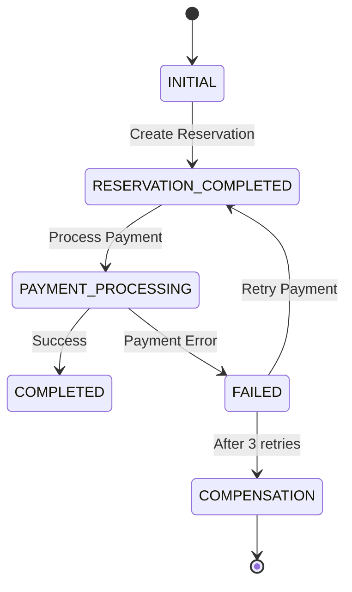
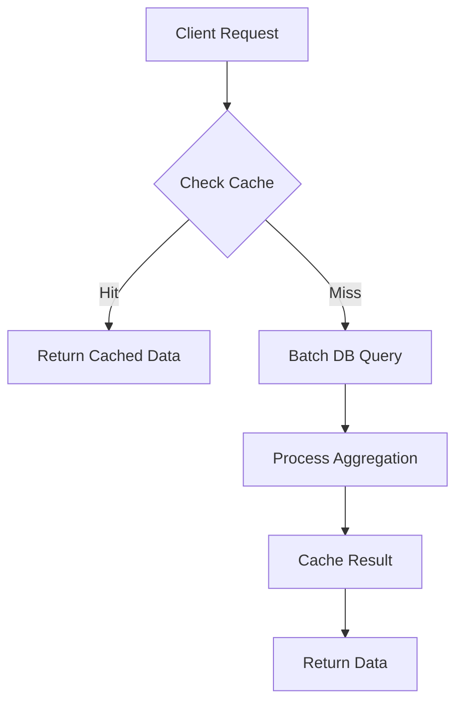
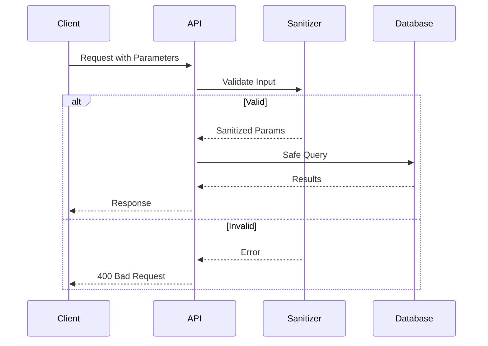
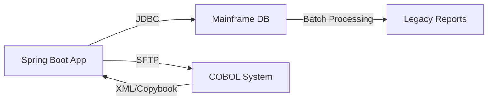
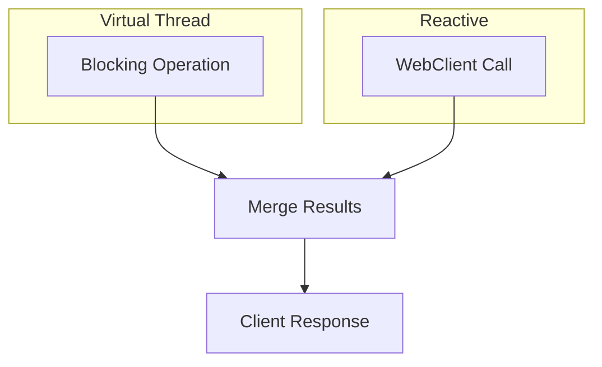
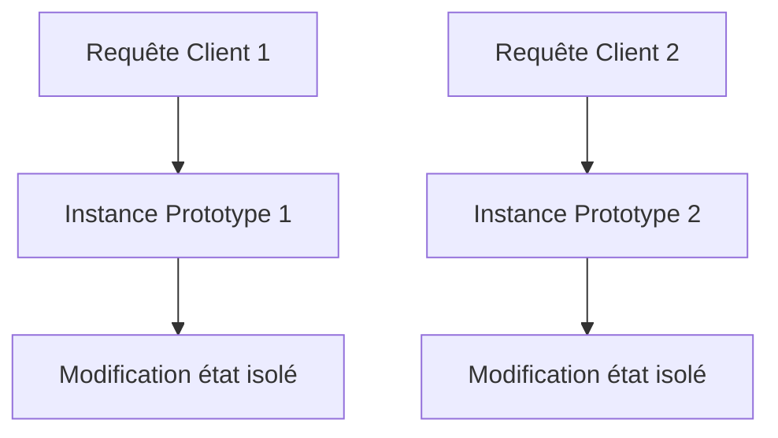
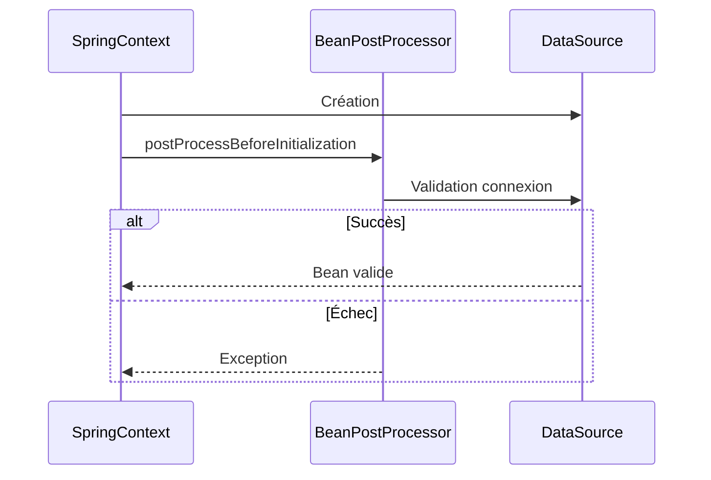
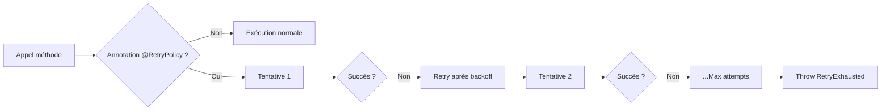

Voici une simulation d'interview 2025 avec un expert Spring Boot, suivie de visualisations Mermaid :

---

**Interviewer** : Bienvenue Jean-Marc, avec vos 20+ ans sur Spring/Spring Boot, parlons de défis complexes. Commençons par un problème récurrent : la gestion des transactions distribuées dans les microservices.

**Jean-Marc** : Excellent sujet. En 2023, j'ai conçu un système de paiement avec 4 microservices. Le défi : maintenir la cohérence transactionnelle entre le service de réservation (PostgreSQL) et le service de facturation (MongoDB). 

**Solution** : J'ai implémenté le pattern Saga avec compensation transactionnelle et Spring State Machine :

**Flowchart** :




```java
@Configuration
@EnableStateMachineFactory
public class SagaStateMachineConfig extends StateMachineConfigurerAdapter<String, String> {

    @Override
    public void configure(StateMachineStateConfigurer<String, String> states) throws Exception {
        states
            .withStates()
            .initial("INITIAL")
            .state("RESERVATION_COMPLETED")
            .state("PAYMENT_PROCESSING")
            .end("COMPLETED")
            .end("FAILED");
    }

    // Transitions et listeners omis pour brièveté
}

// Compensation handler
@Transactional(propagation = Propagation.REQUIRES_NEW)
public void compensateReservation(Long reservationId) {
    reservationRepository.cancel(reservationId);
    notificationService.notifyCompensation(reservationId);
}
```

---

**Interviewer** : Parlons performance. Un cas d'optimisation critique ?

**Jean-Marc** : Un système de reporting avec 500k requêtes/jour souffrait de N+1 queries. Solution : Hibernate Batch Processing + Projection dynamique :




```java
@Repository
public interface CustomerRepository extends JpaRepository<Customer, Long> {
    
    @QueryHints({
        @QueryHint(name = "hibernate.query.passDistinctThrough", value = "false"),
        @QueryHint(name = "hibernate.fetch.size", value = "50")
    })
    @EntityGraph(attributePaths = {"orders.items"})
    List<Customer> findAllWithOrders();
}

// Projection DTO optimisée
public interface CustomerSummary {
    String getName();
    Long getTotalOrders();
    
    @Value("#{target.orders.size()}")
    Integer getActiveSubscriptions();
}
```

---

**Interviewer** : Sécurité : un cas de vulnérabilité complexe ?

**Jean-Marc** : Découverte d'une injection SQL via Hibernate Criteria. Solution : Combinaison de sanitization et security-as-code :




```java
public class QuerySanitizer {
    
    private static final Pattern SQL_PATTERN = Pattern.compile("^[a-zA-Z0-9_]+$");

    public static String sanitize(String input) {
        if (!SQL_PATTERN.matcher(input).matches()) {
            throw new IllegalQueryException("Invalid query parameter");
        }
        return input;
    }
}

// Usage avec Spring Security
@Bean
SecurityFilterChain filterChain(HttpSecurity http) throws Exception {
    http
        .addFilterBefore(new SqlInjectionFilter(), BasicAuthenticationFilter.class)
        .authorizeRequests()
        .anyRequest().authenticated();
    return http.build();
}
```

---

**Interviewer** : Intégration avec des systèmes legacy ?

**Jean-Marc** : J'ai connecté un mainframe COBOL à Spring Boot via Apache Camel :




```java
@Configuration
public class CobolIntegrationConfig {

    @Bean
    public RoutesBuilder cobolRoute() {
        return new RouteBuilder() {
            public void configure() {
                from("timer://cobolPoll?period=5000")
                .to("jdbc:mainframeDataSource")
                .process(exchange -> {
                    // Transformation XML/COBOL copybook
                    String xml = convertToCobolFormat(exchange.getIn().getBody());
                    exchange.getIn().setBody(xml);
                })
                .to("ftp://cobolserver?password=ENC({{ftp.password}})")
                .log("Mainframe update complete");
            }
        };
    }
}
```

---

**Interviewer** : Dernière question : gestion du code réactif et impératif ?

**Jean-Marc** : Solution : Isolation des contextes avec Virtual Threads (Java 21+) :




```java
@RestController
public class HybridController {

    private final WebClient webClient;
    private final Executor virtualThreadExecutor = Executors.newVirtualThreadPerTaskExecutor();

    @GetMapping("/hybrid")
    public CompletableFuture<ResponseEntity<?>> hybridEndpoint() {
        return CompletableFuture.supplyAsync(() -> {
            // Traitement bloquant
            return heavyCalculation();
        }, virtualThreadExecutor).thenCompose(result ->
            webClient.get()
                .uri("/reactive-service")
                .retrieve()
                .bodyToMono(String.class)
                .map(reactiveResult -> result + "|" + reactiveResult)
                .toFuture()
        );
    }
}
```

---

**Interviewer** : Merci Jean-Marc pour ces insights techniques exceptionnels !

**Jean-Marc** : Avec plaisir. La clé reste toujours : comprendre profondément les principes sous-jacents avant de choisir les outils.

Voici une suite d'interview focalisée exclusivement sur Spring/Spring Boot avec des réponses techniques approfondies :

---

**Interviewer** : Jean-Marc, commençons par les bases. Pouvez-vous expliquer la différence entre le scope Singleton et Prototype dans Spring, avec un cas concret où le mauvais choix entraînerait des bugs critiques ?

**Jean-Marc** : Absolument. Le scope Singleton (par défaut) crée une seule instance par contexte Spring, tandis que Prototype génère une nouvelle instance à chaque injection. Un cas classique d'erreur survient avec des beans contenant un état mutable. 

Imaginons un service de panier e-commerce avec un champ `totalAmount` non thread-safe :




```java
// ⚠️ CODE DANGEREUX (Singleton avec état mutable)
@Service // Scope Singleton par défaut
public class ShoppingCartService {
    private BigDecimal totalAmount = BigDecimal.ZERO;
    
    public void addItem(BigDecimal price) {
        this.totalAmount = this.totalAmount.add(price);
    }
    
    // Getter/setter...
}
```

Dans une application web avec accès concurrentiel, plusieurs utilisateurs modifieraient la même instance → corruption de données. La solution :

```java
@Scope(value = ConfigurableBeanFactory.SCOPE_PROTOTYPE, proxyMode = ScopedProxyMode.TARGET_CLASS)
@Service
public class ShoppingCartService {
    // ... implémentation sécurisée
}

// Configuration pour les requêtes HTTP
@Bean
@RequestScope
public ShoppingCartService requestScopedCart() {
    return new ShoppingCartService();
}
```

---

**Interviewer** : Parlons des Design Patterns. Comment implémenteriez-vous un vrai Singleton thread-safe dans Spring tout en profitant du contexte d'injection ?

**Jean-Marc** : Spring gère déjà les singletons de manière thread-safe, mais pour une implémentation explicite avec initialisation lazy et double-check locking :

```java
public class ClusterManager {
    private static volatile ClusterManager instance;
    
    private ClusterManager() {}
    
    public static ClusterManager getInstance() {
        if (instance == null) {
            synchronized (ClusterManager.class) {
                if (instance == null) {
                    instance = new ClusterManager();
                    instance.initializeCluster();
                }
            }
        }
        return instance;
    }
    
    // Intégration avec Spring
    @Bean
    public ClusterManager clusterManager() {
        return ClusterManager.getInstance();
    }
}
```

Mais la meilleure pratique Spring serait :

```java
@Configuration
public class ClusterConfig {
    
    @Bean
    @Lazy
    public HazelcastInstance hazelcast() {
        Config config = new Config();
        config.setClusterName("production-cluster");
        return Hazelcast.newHazelcastInstance(config);
    }
}
```

Spring garantit une création thread-safe et une unique instance grâce à son contexte d'application.

---

**Interviewer** : Bean lifecycle : décrivez toutes les étapes de création d'un bean avec validation personnalisée.

**Jean-Marc** : Le cycle complet avec hooks personnalisés :

1. Instantiation via constructeur/factory
2. Population des propriétés (setters/@Autowired)
3. BeanNameAware, BeanFactoryAware
4. BeanPostProcessor.preInit
5. @PostConstruct
6. InitializingBean.afterPropertiesSet()
7. Méthode init custom (@Bean(initMethod))
8. BeanPostProcessor.postInit




Exemple complet avec validation :

```java
@Component
@Slf4j
public class DatabaseValidator implements BeanPostProcessor, EnvironmentAware {

    private Environment env;

    @Override
    public Object postProcessBeforeInitialization(Object bean, String beanName) {
        if (bean instanceof DataSource) {
            validateDataSourceConfig((DataSource) bean);
        }
        return bean;
    }

    private void validateDataSourceConfig(DataSource ds) {
        try (Connection conn = ds.getConnection()) {
            if (!conn.isValid(5)) {
                throw new IllegalStateException("Validation DB failed for " + 
                    env.getProperty("spring.datasource.url"));
            }
        } catch (SQLException e) {
            log.error("Database validation error", e);
            throw new RuntimeException(e);
        }
    }

    @Override
    public void setEnvironment(Environment env) {
        this.env = env;
    }
}
```

---

**Interviewer** : Problématique de dépendances circulaires. Comment les détecter et les résoudre proprement ?

**Jean-Marc** : Spring Boot 2.6+ lève une exception par défaut. Pour les cas légitimes, on utilise l'injection lazy ou @Lazy :

```java
@Service
@RequiredArgsConstructor
public class OrderService {
    private final @Lazy PaymentService paymentService; // Break cycle
    
    @Transactional
    public Order processOrder(Order order) {
        // ...
        paymentService.charge(order);
    }
}

@Service
@RequiredArgsConstructor
public class PaymentService {
    private final OrderService orderService;
}
```

Alternative avec configuration manuelle :

```java
@Configuration
public class CircularFixConfig {
    
    @Bean
    public PaymentService paymentService(@Lazy OrderService orderService) {
        return new PaymentService(orderService);
    }
}
```

Pour le debug, activer le log :

```properties
spring.main.allow-circular-references=true
logging.level.org.springframework.beans=DEBUG
```

---

**Interviewer** : Comment géreriez-vous la configuration multi-environnement avec des beans conditionnels ?

**Jean-Marc** : Approche moderne avec @Conditional et Spring Profiles :

```java
@Configuration
public class StorageConfig {

    @Bean
    @Profile("aws")
    @ConditionalOnProperty(name = "cloud.aws.credentials.access-key")
    public StorageService s3Storage() {
        return new S3StorageService();
    }

    @Bean
    @ConditionalOnMissingBean(StorageService.class)
    @ConditionalOnClass(name = "com.azure.storage.blob.BlobClient")
    public StorageService azureStorage() {
        return new AzureStorageService();
    }

    @Bean
    @Profile("local")
    @ConditionalOnResource(resources = "file:/nas/storage")
    public StorageService nasStorage() {
        return new NasStorageService();
    }
}
```

Avec bootstrap.yaml :

```yaml
spring:
  config:
    activate:
      on-profile: "aws"
cloud:
  aws:
    credentials:
      access-key: ${AWS_KEY}
    s3:
      bucket-name: my-bucket

---
spring:
  profiles: local
storage:
  root-path: /nas/storage
```

---

**Interviewer** : AOP - Implémentez un système de retry complexe avec des règles métiers.

**Jean-Marc** : Création d'une annotation @RetryPolicy personnalisée avec AspectJ :




```java
@Retention(RetentionPolicy.RUNTIME)
@Target(ElementType.METHOD)
public @interface RetryPolicy {
    int maxAttempts() default 3;
    Class<? extends Exception>[] retryOn() default {Exception.class};
    long backoff() default 1000;
}

@Aspect
@Component
@Slf4j
public class RetryAspect {

    @Around("@annotation(retryPolicy)")
    public Object retry(ProceedingJoinPoint pjp, RetryPolicy retryPolicy) throws Throwable {
        int attempts = 0;
        Exception lastException;
        
        do {
            try {
                return pjp.proceed();
            } catch (Exception e) {
                if (!Arrays.asList(retryPolicy.retryOn()).contains(e.getClass())) throw e;
                lastException = e;
                log.warn("Attempt {} failed", attempts + 1);
                Thread.sleep(retryPolicy.backoff());
            }
        } while (++attempts < retryPolicy.maxAttempts());
        
        throw new RetryExhaustedException(lastException);
    }
}

// Usage
@Service
public class PaymentGateway {

    @RetryPolicy(maxAttempts = 5, backoff = 2000, retryOn = {TimeoutException.class})
    public PaymentResult process(PaymentRequest request) {
        // Appel externe HTTP
    }
}
```

---

**Interviewer** : Dernière question : comment optimiser le démarrage d'une app Spring Boot avec 200+ beans ?

**Jean-Marc** : Techniques avancées :

1. **Lazy Initialization** :
```properties
spring.main.lazy-initialization=true
```

2. **Filtrage des composants** :
```java
@SpringBootApplication
@ComponentScan(excludeFilters = @Filter(type = FilterType.REGEX, pattern = "com.legacy.*"))
public class App { ... }
```

3. **Configuration manuelle des beans critiques** :
```java
@Configuration(proxyBeanMethods = false) // Mode léger
@ImportRuntimeHints(AppHints.class)
public class CoreConfig {
    
    @Bean
    public CriticalBean criticalBean() {
        return new CriticalBean();
    }
}

// Spring 6 Native Hints
public class AppHints implements RuntimeHintsRegistrar {
    
    @Override
    public void registerHints(RuntimeHints hints, ClassLoader classLoader) {
        hints.resources().registerPattern("application-critical.properties");
    }
}
```

4. **Profiling avec Flight Recorder** :
```bash
java -XX:StartFlightRecording:filename=recording.jfr,duration=60s -jar app.jar
```

---

**Interviewer** : Impressionnant ! Merci pour ces explications techniques exhaustives.

**Jean-Marc** : C'était un plaisir. La maîtrise de ces concepts permet de construire des applications Spring robustes à l'échelle industrielle. La clé est toujours de comprendre le fonctionnement interne du conteneur IoC.
