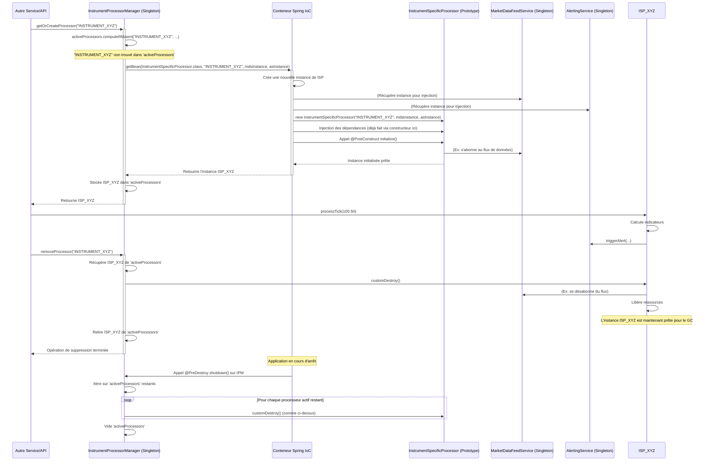

Absolument ! Préparons cette simulation d'entretien pour 2025.

## Scénario d'Entretien Technique Senior – Spring/Spring Boot (2025)

**Interviewer :** Bonjour et bienvenue. Merci de prendre le temps pour cet entretien. Avec plus de 20 ans d'expérience, notamment sur l'écosystème Spring et Spring Boot, vous avez sans doute vu et résolu des défis techniques considérables. Aujourd'hui, j'aimerais que nous discutions de certains des problèmes les plus complexes que vous avez rencontrés et des solutions que vous avez mises en œuvre.

**Candidat (Vous) :** Bonjour. Merci de me recevoir. Effectivement, deux décennies avec Spring, c'est une longue histoire, riche en évolutions et en défis passionnants. Je suis prêt à partager mon expérience.

------

**Interviewer :** Excellent. Commençons par un classique modernisé. Imaginez une plateforme e-commerce d'envergure, avec une architecture microservices. Un des défis majeurs est la **gestion de la cohérence des données distribuées lors du processus de commande**, impliquant le service de commande, le service d'inventaire, le service de paiement et le service de notification. Décrivez un problème complexe que vous avez rencontré dans ce contexte et comment vous l'avez résolu en utilisant les meilleures pratiques Spring Boot et Java.

**Candidat :** C'est un excellent point de départ. Un problème très courant et complexe dans ce type d'architecture est la **garantie de l'atomicité apparente d'une transaction métier qui s'étend sur plusieurs services**. Par exemple, un client passe une commande : il faut réserver l'inventaire, traiter le paiement, puis confirmer la commande et notifier le client. Si l'une de ces étapes échoue (par exemple, le paiement est refusé après que l'inventaire a été réservé), nous devons nous assurer que le système revient à un état cohérent, évitant par exemple de bloquer indéfiniment des articles en stock ou de facturer un client pour une commande non finalisée.

Le défi principal ici est l'absence de transactions distribuées ACID natives et performantes dans un environnement microservices hétérogène et à grande échelle. Utiliser des protocoles comme XA (Two-Phase Commit) est souvent trop coûteux en termes de couplage, de performance et de complexité opérationnelle.

**Solution Apportée : Le Pattern Saga avec Chorégraphie**

Pour résoudre ce problème, j'ai privilégié l'implémentation du **pattern Saga** sous sa forme chorégraphiée, en utilisant **Apache Kafka** comme bus d'événements et Spring Boot avec **Spring Kafka** et **Spring Cloud Stream**.

1. **Découpage en Transactions Locales :** Chaque service impliqué (Commande, Inventaire, Paiement, Notification) gère sa propre transaction locale ACID.
2. **Communication par Événements :** Lorsqu'un service termine sa transaction locale avec succès, il publie un événement sur un topic Kafka. Les services suivants s'abonnent à ces événements pour déclencher leurs propres transactions locales.
3. **Compensation :** Pour chaque action (par exemple, `RéserverInventaire`), une action de compensation correspondante (par exemple, `LibérerInventaire`) est définie. Si une étape de la saga échoue, les services qui ont déjà terminé leur part publient des événements de compensation ou écoutent des événements d'échec pour déclencher leurs actions de compensation.

**Exemple de Flux (Happy Path) :**

- **Service Commande :** Reçoit la requête de création de commande. Crée une commande avec le statut `PENDING`. Publie `CommandeCrééeEvent`.
- **Service Inventaire :** Consomme `CommandeCrééeEvent`. Réserve l'inventaire. Publie `InventaireRéservéEvent`.
- **Service Paiement :** Consomme `InventaireRéservéEvent`. Traite le paiement. Publie `PaiementRéussiEvent`.
- **Service Commande :** Consomme `PaiementRéussiEvent`. Met à jour le statut de la commande à `CONFIRMED`. Publie `CommandeConfirméeEvent`.
- **Service Notification :** Consomme `CommandeConfirméeEvent`. Envoie une notification au client.

**Exemple de Flux (Failure Path - Paiement Échoue) :**

- ...
- **Service Paiement :** Consomme `InventaireRéservéEvent`. Le traitement du paiement échoue. Publie `PaiementÉchouéEvent`.
- **Service Inventaire :** Consomme `PaiementÉchouéEvent`. Déclenche l'action de compensation : libère l'inventaire. Publie `InventaireLibéréEvent` (ou un événement d'erreur général).
- **Service Commande :** Consomme `PaiementÉchouéEvent`. Met à jour le statut de la commande à `FAILED` ou `CANCELLED`. Publie `CommandeAnnuléeEvent`.
- **Service Notification :** (Optionnel) Peut consommer `PaiementÉchouéEvent` ou `CommandeAnnuléeEvent` pour notifier le client de l'échec.

**Points Clés de l'Implémentation avec Spring Boot :**

- Spring Kafka / Spring Cloud Stream :

   Simplifie grandement la production et la consommation de messages Kafka.

  - Utilisation de `KafkaTemplate` pour la publication.
  - Annotations `@KafkaListener` ou les binders de Spring Cloud Stream (`@StreamListener` avant, maintenant les approches fonctionnelles avec `Consumer<T>`, `Function<T,R>`, `Supplier<T>`) pour la consommation.

- **Idempotence des Consommateurs :** Crucial pour éviter les traitements multiples en cas de redélivraison de messages. Géré en stockant les IDs des messages déjà traités (par exemple, dans un Redis ou une table de la base de données locale).

- Gestion des Erreurs et Retries :

  - Spring Retry pour les retentatives sur des opérations potentiellement transitoires (appel réseau, etc.).
  - Dead Letter Topics (DLT) dans Kafka, configurés via Spring Kafka, pour les messages qui ne peuvent pas être traités après plusieurs tentatives, permettant une analyse et une intervention manuelles.

- Observabilité :

  - **Spring Cloud Sleuth** (ou Micrometer Tracing à partir de Spring Boot 3) pour le traçage distribué à travers les services via les messages Kafka (propagation des `traceId` et `spanId`).
  - **Micrometer** pour les métriques (nombre de messages traités, temps de traitement, erreurs).

- Tests :

  - **Tests unitaires** avec Mockito pour les logiques métier.
  - **Tests d'intégration** avec `@SpringBootTest` et `spring-kafka-test` (Embedded Kafka) pour tester les flux de messages en isolation.
  - **Tests de Contrat** (par ex. avec Spring Cloud Contract) pour s'assurer que les producteurs et consommateurs d'événements respectent les schémas attendus.

------

**Interviewer :** C'est une solution robuste et bien articulée. Pourriez-vous fournir un extrait de code Java/Spring Boot illustrant, par exemple, la publication d'un événement par le service de commande et la consommation par le service d'inventaire, en mettant en évidence la gestion de la compensation en cas d'échec ?

**Candidat :** Bien sûr. Voici des exemples simplifiés.

**Service Commande (OrderService) :**

Java

```java
// OrderService.java
package com.example.orderservice.service;

import com.example.orderservice.event.OrderCreatedEvent;
import com.example.orderservice.model.Order;
import com.example.orderservice.repository.OrderRepository;
import org.slf4j.Logger;
import org.slf4j.LoggerFactory;
import org.springframework.beans.factory.annotation.Autowired;
import org.springframework.kafka.core.KafkaTemplate;
import org.springframework.stereotype.Service;
import org.springframework.transaction.annotation.Transactional;

@Service
public class OrderService {

    private static final Logger LOGGER = LoggerFactory.getLogger(OrderService.class);
    private static final String ORDER_TOPIC = "order-events";

    @Autowired
    private OrderRepository orderRepository;

    @Autowired
    private KafkaTemplate<String, Object> kafkaTemplate;

    @Transactional
    public Order createOrder(Order order) {
        // Logique de création de commande
        order.setStatus("PENDING_INVENTORY");
        Order savedOrder = orderRepository.save(order);
        
        OrderCreatedEvent event = new OrderCreatedEvent(savedOrder.getId(), savedOrder.getProductId(), savedOrder.getQuantity());
        kafkaTemplate.send(ORDER_TOPIC, "OrderCreated", event);
        LOGGER.info("Sent OrderCreatedEvent for orderId: {}", savedOrder.getId());
        
        return savedOrder;
    }

    @Transactional
    public void processPaymentFailed(Long orderId) {
        Order order = orderRepository.findById(orderId).orElseThrow(() -> new RuntimeException("Order not found"));
        order.setStatus("ORDER_CANCELLATION_REQUESTED_PAYMENT_FAILED"); // Indique la raison
        orderRepository.save(order);
        LOGGER.info("Order status updated to CANCELLATION_REQUESTED_PAYMENT_FAILED for orderId: {}", orderId);
        // Ici, on pourrait publier un OrderCancellationRequestedEvent si d'autres services devaient réagir
        // Mais dans notre saga chorégraphiée, c'est souvent l'initiateur de l'échec (Paiement)
        // qui publie l'événement d'échec que les autres consomment pour compenser.
    }

     @Transactional
    public void confirmOrder(Long orderId) {
        Order order = orderRepository.findById(orderId).orElseThrow(() -> new RuntimeException("Order not found"));
        order.setStatus("CONFIRMED");
        orderRepository.save(order);
        LOGGER.info("Order status updated to CONFIRMED for orderId: {}", orderId);
        // Publier un OrderConfirmedEvent pour le service de notification, par exemple
        // kafkaTemplate.send("notification-topic", new OrderConfirmedEvent(orderId));
    }
}

// OrderCreatedEvent.java (Record pour la concision en Java 17+)
package com.example.orderservice.event;

public record OrderCreatedEvent(Long orderId, String productId, int quantity) {}

// PaymentFailedEvent.java (Consommé par OrderService)
package com.example.paymentservice.event; // Supposons qu'il vienne du service de paiement

public record PaymentFailedEvent(Long orderId, String reason) {}

// PaymentSuccessListener.java (dans OrderService, écoutant l'événement du service de paiement)
package com.example.orderservice.listener;

import com.example.paymentservice.event.PaymentFailedEvent; // Supposons
import com.example.paymentservice.event.PaymentSuccessfulEvent; // Supposons
import com.example.orderservice.service.OrderService;
import org.slf4j.Logger;
import org.slf4j.LoggerFactory;
import org.springframework.beans.factory.annotation.Autowired;
import org.springframework.kafka.annotation.KafkaListener;
import org.springframework.stereotype.Component;

@Component
public class PaymentEventListener {

    private static final Logger LOGGER = LoggerFactory.getLogger(PaymentEventListener.class);

    @Autowired
    private OrderService orderService;

    private static final String PAYMENT_EVENTS_TOPIC = "payment-events"; // Topic où le service de paiement publie

    @KafkaListener(topics = PAYMENT_EVENTS_TOPIC, groupId = "order-group", containerFactory = "paymentEventListenerContainerFactory",
                   filter = "T(new String(__listener.keyDeserializer().deserialize('', __listener.key()))).equals('PaymentSuccessful')")
    public void handlePaymentSuccessful(PaymentSuccessfulEvent event) {
        LOGGER.info("Received PaymentSuccessfulEvent for orderId: {}", event.orderId());
        orderService.confirmOrder(event.orderId());
    }
    
    @KafkaListener(topics = PAYMENT_EVENTS_TOPIC, groupId = "order-group", containerFactory = "paymentEventListenerContainerFactory",
                   filter = "T(new String(__listener.keyDeserializer().deserialize('', __listener.key()))).equals('PaymentFailed')")
    public void handlePaymentFailed(PaymentFailedEvent event) {
        LOGGER.info("Received PaymentFailedEvent for orderId: {}, reason: {}", event.orderId(), event.reason());
        // Le service Commande initie la compensation en son sein et informe d'autres si nécessaire
        orderService.processPaymentFailed(event.orderId()); 
        // Il pourrait aussi publier un "OrderCancellationInitiatedEvent" que l'inventaire écouterait.
        // Mais souvent, le service d'inventaire écoute directement PaymentFailedEvent.
    }
}
```

**Service Inventaire (InventoryService) :**

**Remarques sur le code :**

- Les `containerFactory` sont configurés pour permettre l'utilisation de `JsonDeserializer` avec des types spécifiques et `ErrorHandlingDeserializer` pour une meilleure robustesse.
- L'utilisation de `filter` sur `@KafkaListener` permet de router les messages vers le bon handler en fonction par exemple d'une clé de message ou d'un header (ici, je simule un routage par clé, ce qui est moins courant que par header de type d'événement). Une approche plus courante serait d'avoir des topics distincts par type d'événement majeur ou d'utiliser les headers Kafka pour le type d'événement.
- La gestion d'idempotence n'est pas montrée ici mais serait essentielle en production.
- Les noms des topics et des groupes de consommateurs doivent être cohérents.
- La désérialisation JSON est configurée pour faire confiance aux packages des événements.

```java
// InventoryService.java
package com.example.inventoryservice.service;

import com.example.inventoryservice.event.InventoryReservationFailedEvent;
import com.example.inventoryservice.event.InventoryReservedEvent;
import com.example.inventoryservice.model.Inventory;
import com.example.inventoryservice.repository.InventoryRepository;
import com.example.orderservice.event.OrderCreatedEvent; // Consommé
import com.example.paymentservice.event.PaymentFailedEvent; // Consommé pour compensation

import org.slf4j.Logger;
import org.slf4j.LoggerFactory;
import org.springframework.beans.factory.annotation.Autowired;
import org.springframework.kafka.annotation.KafkaListener;
import org.springframework.kafka.core.KafkaTemplate;
import org.springframework.stereotype.Service;
import org.springframework.transaction.annotation.Transactional;

@Service
public class InventoryService {

    private static final Logger LOGGER = LoggerFactory.getLogger(InventoryService.class);
    private static final String INVENTORY_TOPIC = "inventory-events";
    private static final String ORDER_TOPIC = "order-events"; // Écoute les commandes
    private static final String PAYMENT_TOPIC = "payment-events"; // Écoute les échecs de paiement

    @Autowired
    private InventoryRepository inventoryRepository;

    @Autowired
    private KafkaTemplate<String, Object> kafkaTemplate;

    @KafkaListener(topics = ORDER_TOPIC, groupId = "inventory-group", containerFactory = "orderEventListenerContainerFactory",
                   filter = "T(new String(__listener.keyDeserializer().deserialize('', __listener.key()))).equals('OrderCreated')")
    @Transactional
    public void handleOrderCreated(OrderCreatedEvent event) {
        LOGGER.info("Received OrderCreatedEvent for orderId: {}, productId: {}, quantity: {}", 
                    event.orderId(), event.productId(), event.quantity());
        
        Inventory item = inventoryRepository.findByProductId(event.productId())
            .orElseThrow(() -> new RuntimeException("Product not found in inventory"));

        if (item.getQuantity() >= event.quantity()) {
            item.setQuantity(item.getQuantity() - event.quantity());
            inventoryRepository.save(item);
            
            InventoryReservedEvent reservedEvent = new InventoryReservedEvent(event.orderId(), event.productId());
            kafkaTemplate.send(INVENTORY_TOPIC, "InventoryReserved", reservedEvent);
            LOGGER.info("Inventory reserved for orderId: {}. Published InventoryReservedEvent.", event.orderId());
        } else {
            // Pas assez de stock -> Saga doit compenser. On publie un échec de réservation d'inventaire.
            InventoryReservationFailedEvent reservationFailedEvent = 
                new InventoryReservationFailedEvent(event.orderId(), event.productId(), "INSUFFICIENT_STOCK");
            kafkaTemplate.send(INVENTORY_TOPIC, "InventoryReservationFailed", reservationFailedEvent);
            LOGGER.warn("Inventory reservation FAILED for orderId: {}. Insufficient stock. Published InventoryReservationFailedEvent.", event.orderId());
            // Le service de commande écoutera cet événement pour annuler la commande.
        }
    }

    // Compensation si le paiement échoue APRÈS que l'inventaire ait été réservé
    @KafkaListener(topics = PAYMENT_TOPIC, groupId = "inventory-group", containerFactory = "paymentEventListenerContainerFactory",
                   filter = "T(new String(__listener.keyDeserializer().deserialize('', __listener.key()))).equals('PaymentFailed')")
    @Transactional
    public void handlePaymentFailed(PaymentFailedEvent event) {
        LOGGER.info("Received PaymentFailedEvent for orderId: {} for compensation.", event.orderId());
        // Ici, il faudrait récupérer la quantité qui avait été réservée pour cette commande.
        // Pour simplifier, on suppose qu'on peut la retrouver ou qu'elle est dans l'événement (pas ici).
        // Admettons qu'on ait une table de "réservations" ou qu'on déduise du `OrderDetails` si on y avait accès.
        // Pour cet exemple, je vais supposer qu'on a une méthode pour retrouver la réservation.
        // restoreInventoryForOrder(event.orderId());
        // Logique pour libérer l'inventaire.
        // Exemple:
        OrderReservationDetails reservation = reservationRepository.findByOrderId(event.orderId());
        Inventory item = inventoryRepository.findByProductId(reservation.getProductId());
        item.setQuantity(item.getQuantity() + reservation.getQuantity());
        inventoryRepository.save(item);
        
        LOGGER.info("Inventory compensated (released) for orderId: {} due to payment failure.", event.orderId());
        // On pourrait publier un InventoryReleasedEvent
        kafkaTemplate.send(INVENTORY_TOPIC, "InventoryReleased", new InventoryReleasedEvent(event.orderId()));
    }
}

// InventoryReservedEvent.java
package com.example.inventoryservice.event;
public record InventoryReservedEvent(Long orderId, String productId) {}

// InventoryReservationFailedEvent.java
package com.example.inventoryservice.event;
public record InventoryReservationFailedEvent(Long orderId, String productId, String reason) {}

// Kafka Consumer Configuration (Exemple pour un des services, à adapter pour les autres)
// KafkaConfig.java
package com.example.inventoryservice.config;

import org.apache.kafka.clients.consumer.ConsumerConfig;
import org.apache.kafka.common.serialization.StringDeserializer;
import org.springframework.context.annotation.Bean;
import org.springframework.context.annotation.Configuration;
import org.springframework.kafka.config.ConcurrentKafkaListenerContainerFactory;
import org.springframework.kafka.core.ConsumerFactory;
import org.springframework.kafka.core.DefaultKafkaConsumerFactory;
import org.springframework.kafka.support.serializer.ErrorHandlingDeserializer;
import org.springframework.kafka.support.serializer.JsonDeserializer;

import java.util.HashMap;
import java.util.Map;

@Configuration
public class KafkaConsumerConfig {

    // Configuration pour le listener OrderCreatedEvent
    @Bean
    public ConcurrentKafkaListenerContainerFactory<String, com.example.orderservice.event.OrderCreatedEvent> orderEventListenerContainerFactory(
            ConsumerFactory<String, com.example.orderservice.event.OrderCreatedEvent> orderEventConsumerFactory) {
        ConcurrentKafkaListenerContainerFactory<String, com.example.orderservice.event.OrderCreatedEvent> factory =
                new ConcurrentKafkaListenerContainerFactory<>();
        factory.setConsumerFactory(orderEventConsumerFactory);
        // Ajouter d'autres configurations si nécessaire (gestion d'erreur, filtres, etc.)
        return factory;
    }

    @Bean
    public ConsumerFactory<String, com.example.orderservice.event.OrderCreatedEvent> orderEventConsumerFactory() {
        Map<String, Object> props = commonConsumerProps();
        // Spécifier le package de confiance pour JsonDeserializer
        props.put(JsonDeserializer.TRUSTED_PACKAGES, "com.example.orderservice.event");
        return new DefaultKafkaConsumerFactory<>(props, new StringDeserializer(),
                new ErrorHandlingDeserializer<>(new JsonDeserializer<>(com.example.orderservice.event.OrderCreatedEvent.class, false)));
    }

    // Configuration pour le listener PaymentFailedEvent (similaire)
    @Bean
    public ConcurrentKafkaListenerContainerFactory<String, com.example.paymentservice.event.PaymentFailedEvent> paymentEventListenerContainerFactory(
            ConsumerFactory<String, com.example.paymentservice.event.PaymentFailedEvent> paymentEventConsumerFactory) {
        ConcurrentKafkaListenerContainerFactory<String, com.example.paymentservice.event.PaymentFailedEvent> factory =
                new ConcurrentKafkaListenerContainerFactory<>();
        factory.setConsumerFactory(paymentEventConsumerFactory);
        return factory;
    }
    
    @Bean
    public ConsumerFactory<String, com.example.paymentservice.event.PaymentFailedEvent> paymentEventConsumerFactory() {
        Map<String, Object> props = commonConsumerProps();
        props.put(JsonDeserializer.TRUSTED_PACKAGES, "com.example.paymentservice.event"); // Package de l'event
        return new DefaultKafkaConsumerFactory<>(props, new StringDeserializer(),
                new ErrorHandlingDeserializer<>(new JsonDeserializer<>(com.example.paymentservice.event.PaymentFailedEvent.class, false)));
    }


    private Map<String, Object> commonConsumerProps() {
        Map<String, Object> props = new HashMap<>();
        props.put(ConsumerConfig.BOOTSTRAP_SERVERS_CONFIG, "localhost:9092"); // A externaliser
        props.put(ConsumerConfig.KEY_DESERIALIZER_CLASS_CONFIG, StringDeserializer.class);
        props.put(Consumer_DESERIALIZER_CLASS_CONFIG, ErrorHandlingDeserializer.class); // Pour la robustesse
        props.put(ErrorHandlingDeserializer.VALUE_DESERIALIZER_CLASS, JsonDeserializer.class.getName());
        props.put(JsonDeserializer.VALUE_DEFAULT_TYPE, Object.class.getName()); // Type par défaut si non spécifié
        // props.put(JsonDeserializer.USE_TYPE_INFO_HEADERS, "false"); // Important si les types ne sont pas dans les headers
        return props;
    }
}
```

------

**Interviewer :** Très clair. Maintenant, pourriez-vous représenter l'ensemble de ce système et le flux de la saga, y compris le chemin de compensation, sous forme de diagramme de flux Mermaid ?

**Candidat :** Certainement. Voici une représentation Mermaid du flux de la saga.

**Explication du diagramme Mermaid :**

- Les rectangles représentent les services.
- Les rectangles avec coins arrondis (par défaut pour Kafka ici) représentent les événements sur les topics Kafka.
- Les flèches indiquent le flux des opérations et des événements.
- Le "Happy Path" montre la séquence réussie.
- Le "Compensation Path" illustre ce qui se passe si le service de paiement échoue :
  - `PaymentFailedEvent` est publié.
  - Le service de commande met à jour le statut de la commande.
  - Le service d'inventaire exécute son action de compensation (libérer l'inventaire).
  - Des notifications appropriées peuvent être envoyées.

```mermaid
graph TD
    subgraph Saga de Commande E-commerce
        Client([Client]) -->|1. Crée Commande| OS(Service Commande)
        
        subgraph "Happy Path"
            OS -- Transaction Locale OK --> K1[Kafka: OrderCreatedEvent]
            K1 --> IS(Service Inventaire)
            IS -- Transaction Locale OK --> K2[Kafka: InventoryReservedEvent]
            K2 --> PS(Service Paiement)
            PS -- Transaction Locale OK --> K3[Kafka: PaymentSuccessfulEvent]
            K3 --> OS_Confirm(Service Commande)
            OS_Confirm -- Met à jour statut Commande --> K4[Kafka: OrderConfirmedEvent]
            K4 --> NS(Service Notification)
            NS -->|Notifie Client| ClientOK([Client Notifié])
        end

        subgraph "Compensation Path (Échec Paiement)"
            PS -- Transaction Locale ÉCHOUE --> K_Fail_Payment[Kafka: PaymentFailedEvent]
            
            K_Fail_Payment --> OS_Cancel(Service Commande)
            OS_Cancel -- Met à jour statut Commande à ÉCHOUÉE/ANNULÉE --> K_Order_Cancelled[Kafka: OrderCancelledEvent]
            K_Order_Cancelled --> NS_Fail(Service Notification)
            NS_Fail -->|Notifie Échec Client| ClientFail([Client Notifié Échec])

            K_Fail_Payment --> IS_Compensate(Service Inventaire)
            IS_Compensate -- Action de Compensation OK (Libère Inventaire) --> K_Inventory_Released[Kafka: InventoryReleasedEvent]
        end

        %% Liaisons entre les étapes de la Saga
        OS --> K1
        IS --> K2
        PS --> K3
        OS_Confirm --> K4

        %% Liaisons pour l'échec
        PS -.-> K_Fail_Payment
        
        %% Flèches de déclenchement pour la compensation
        K_Fail_Payment -.-> OS_Cancel
        K_Fail_Payment -.-> IS_Compensate

        %% Style
        classDef service fill:#f9f,stroke:#333,stroke-width:2px;
        classDef kafka fill:#ccf,stroke:#333,stroke-width:2px;
        classDef client fill:#9cf,stroke:#333,stroke-width:2px;

        class Client,ClientOK,ClientFail client;
        class OS,IS,PS,NS,OS_Confirm,OS_Cancel,IS_Compensate,NS_Fail service;
        class K1,K2,K3,K4,K_Fail_Payment,K_Order_Cancelled,K_Inventory_Released kafka;
    end
```



------

**Interviewer :** C'est une excellente illustration. Au-delà de la gestion des sagas, quels autres défis complexes liés à la **performance et à la scalabilité** avez-vous dû surmonter avec Spring Boot en 2024-2025, et quelles ont été vos approches ? Je pense notamment à la gestion de la latence, au C10k problem, ou à l'optimisation des ressources.

Candidat : Effectivement, avec la croissance des systèmes, la performance et la scalabilité sont des préoccupations constantes.

Un défi majeur rencontré récemment concernait un service Spring Boot RESTful synchrone qui agissait comme un goulot d'étranglement car il effectuait plusieurs appels I/O bloquants en aval (autres microservices, bases de données). Sous forte charge, le pool de threads Tomcat était rapidement saturé, entraînant une augmentation drastique de la latence et des timeouts.

**Solution Apportée : Passage au Réactif avec Project Reactor et WebFlux**

1. **Analyse et Identification :** Utilisation de Micrometer pour les métriques (saturation du pool de threads, latence des appels) et de Spring Cloud Sleuth/Zipkin pour visualiser les spans et identifier les opérations I/O les plus longues.
2. **Adoption de WebFlux :** Remplacement de Spring MVC (Tomcat/Servlet API) par Spring WebFlux (Netty/Event Loop). Cela permet de gérer un grand nombre de connexions concurrentes avec un nombre limité de threads, en évitant le blocage des threads par requête.
3. Programmation Réactive de bout en bout :
   - Utilisation de `Mono` et `Flux` de Project Reactor pour toutes les opérations I/O.
   - Remplacement des clients HTTP bloquants (comme `RestTemplate`) par `WebClient` non-bloquant.
   - Utilisation de drivers de base de données réactifs (par exemple, R2DBC pour les bases SQL, ou les drivers réactifs natifs pour NoSQL comme MongoDB, Cassandra).
   - `flatMap`, `map`, `zip`, `onErrorResume` etc. pour composer les flux de données de manière non-bloquante.
4. **Optimisation du Backpressure :** Gestion fine du backpressure pour s'assurer que les producteurs de données n'submergent pas les consommateurs.
5. **Configuration de Netty :** Ajustement des paramètres de Netty (nombre de threads dans l'event loop, etc.) en fonction des caractéristiques de la charge et des ressources disponibles.
6. **Tests de Charge :** Utilisation d'outils comme k6, Gatling ou JMeter pour valider les gains de performance et de scalabilité, et pour identifier de nouveaux goulots d'étranglement potentiels.

**Impact :**

- Réduction significative de la latence moyenne et percentile (P95, P99).
- Augmentation du débit (requêtes par seconde) supporté par instance.
- Meilleure utilisation des ressources CPU et mémoire, car moins de threads sont nécessaires.

Un autre aspect exploré en 2025, c'est l'utilisation de **GraalVM Native Image** avec Spring Native. Pour certains services critiques où le temps de démarrage et l'empreinte mémoire sont primordiaux (fonctions FaaS, microservices scalant très rapidement à zéro), la compilation en image native a offert des gains substantiels, bien que cela vienne avec certaines contraintes de développement (nécessité de configuration pour la réflexion, les proxies, etc.).

------

**Interviewer :** Très intéressant, le passage au réactif est en effet une stratégie clé. Pour finir, en considérant l'évolution de Spring et de l'écosystème Java, quelles sont selon vous les **compétences ou technologies émergentes** qu'un développeur Spring senior se doit de maîtriser ou d'explorer activement en 2025 pour rester pertinent et efficace face aux défis futurs ?

**Candidat :** C'est une excellente question pour anticiper. En 2025, au-delà d'une maîtrise solide des fondamentaux de Spring Boot, je vois plusieurs axes :

1. **Approfondissement du Réactif :** Non seulement WebFlux, mais aussi R2DBC, et une compréhension fine des opérateurs Reactor et de la gestion du backpressure sont indispensables pour les systèmes I/O intensifs.
2. **Cloud Native & Kubernetes :** Une connaissance approfondie du déploiement, de la configuration (par exemple, avec Spring Cloud Kubernetes), de la surveillance et de l'auto-scaling des applications Spring Boot dans Kubernetes. Cela inclut la maîtrise des concepts comme les Service Mesh (Istio, Linkerd) pour la communication inter-services, la sécurité et l'observabilité.
3. **Observabilité Approfondie :** Au-delà de Sleuth/Micrometer, savoir intégrer et exploiter des plateformes d'observabilité complètes (comme des stacks basées sur Prometheus, Grafana, Loki, Jaeger/Tempo ou des solutions commerciales). Comprendre l'OpenTelemetry comme standard.
4. **Sécurité Avancée :** Maîtrise de Spring Security dans des contextes complexes (OAuth2/OIDC, JWT, mTLS), sécurisation des communications dans les architectures distribuées, gestion des secrets, et pratiques de DevSecOps.
5. **GraalVM & Spring Native :** Comprendre quand et comment utiliser la compilation AOT pour optimiser les performances de démarrage et l'empreinte mémoire, ainsi que les compromis associés.
6. **Architectures Événementielles Avancées :** Maîtrise approfondie des patterns (Event Sourcing, CQRS en plus des Sagas), et des brokers de messages (Kafka, Pulsar) avec leurs spécificités (streaming, gestion des schémas, etc.).
7. **IA et Machine Learning dans les Applications Java :** Avec l'essor de l'IA, être capable d'intégrer des modèles de ML dans les applications Spring Boot (par exemple, via des API ou des bibliothèques Java comme DJL - Deep Java Library) devient de plus en plus pertinent pour certains cas d'usage. Spring AI commence également à prendre de l'ampleur.
8. **Modularité et Évolution d'Architecture :** Continuer à maîtriser les techniques de découplage, les principes SOLID, et les approches pour faire évoluer des systèmes complexes (par exemple, le pattern Strangler Fig pour moderniser des monolithes).

Rester curieux et pratiquer continuellement via des projets personnels ou des contributions open-source est la clé.

------

**Interviewer :** C'est une vision très complète et pertinente. Merci beaucoup pour ce partage d'expérience détaillé et pour la qualité de vos réponses. Avez-vous des questions de votre côté ?

**Candidat :** Oui, j'aimerais en savoir plus sur les défis techniques spécifiques que votre équipe rencontre actuellement et sur la vision technologique de l'entreprise pour les deux prochaines années, notamment concernant l'adoption des technologies que nous avons évoquées.

**(Fin de la simulation)**

Okay, je comprends parfaitement. Nous allons recentrer la discussion sur les mécanismes internes de Spring et Spring Boot, en explorant plus en profondeur la gestion des beans, leurs portées, le cycle de vie, l'injection de dépendances et la puissance de l'auto-configuration et de la configuration personnalisée.

------

**Interviewer :** Votre explication sur le pattern Saga était très instructive et mettait bien en lumière l'utilisation de Spring avec des systèmes externes comme Kafka. Maintenant, j'aimerais que nous plongions davantage au cœur de Spring lui-même.

Imaginons un scénario différent, toujours en 2025. Vous travaillez sur une application de trading haute fréquence qui doit traiter des flux de données de marché pour un grand nombre d'instruments financiers (actions, obligations, etc.). Pour chaque instrument actif, l'application doit maintenir un **processeur de données dédié et étatiste** (stateful). Ce processeur accumule des ticks de prix, calcule des indicateurs en temps réel (moyennes mobiles, volumes, etc.) et peut déclencher des alertes.

La création de chaque processeur est coûteuse en ressources (initialisation de structures de données complexes, potentiellement chargement de données historiques de référence). Le nombre d'instruments actifs peut varier dynamiquement.

Quels mécanismes Spring spécifiques utiliseriez-vous pour concevoir et gérer ces processeurs de données étatistes, en assurant l'isolation entre eux, une gestion efficace de leur cycle de vie, et comment l'injection de dépendances fonctionnerait-elle dans ce contexte ? Mettez l'accent sur les solutions "pures" Spring/Spring Boot.

------

**Candidat :** C'est un défi très intéressant qui touche directement à la gestion fine des beans et à leur cycle de vie dans Spring.

Le besoin principal ici est de gérer des instances multiples, indépendantes et étatistes de "processeurs d'instrument", où chaque instance est dédiée à un instrument financier spécifique. Le fait que leur initialisation soit coûteuse et que leur nombre soit dynamique oriente clairement la solution.

**Solution Proposée : Beans Prototype et Gestion Programmatique**

1. Portée des Beans : @Scope("prototype")

   La solution la plus idiomatique dans Spring pour des objets étatistes dont on a besoin de multiples instances indépendantes est la portée prototype. Contrairement aux singletons (portée par défaut), chaque fois qu'une requête est faite au conteneur Spring pour un bean de portée prototype, une nouvelle instance est créée. Cela garantit l'isolation de l'état entre les processeurs de différents instruments.

2. Gestion du Cycle de Vie des Prototypes

   Un point crucial avec les beans prototype est que le conteneur Spring gère leur création et l'injection de dépendances, mais ne gère pas leur cycle de vie complet après leur création. Plus précisément, les callbacks de destruction (@PreDestroy, DisposableBean) ne sont pas automatiquement invoqués pour les beans prototype. C'est la responsabilité du code client qui a obtenu le bean prototype de gérer sa destruction et la libération des ressources.

   Cependant, les callbacks d'initialisation (@PostConstruct, InitializingBean) sont invoqués après l'injection des dépendances.

3. Obtention des Instances Prototype

   Puisque nous avons besoin de créer dynamiquement ces processeurs, un service singleton (par exemple, InstrumentProcessorManager) sera responsable de demander et de gérer les instances prototype. Pour obtenir ces instances, nous pouvons utiliser :

   - **`ObjectFactory<InstrumentProcessor>` (ou `Provider<InstrumentProcessor>` de JSR-330) :** C'est une manière propre d'injecter une factory capable de produire des instances de `InstrumentProcessor` à la demande.
   - **Lookup Method Injection (`@Lookup`) :** Une méthode annotée avec `@Lookup` sur le bean manager singleton peut être déclarée pour retourner une nouvelle instance du bean prototype. Spring va dynamiquement surcharger cette méthode pour qu'elle récupère le bean du contexte.

4. **Configuration et Auto-Configuration**

   - **`@Configuration` :** Une classe de configuration définira le bean `InstrumentProcessor` avec la portée `@Scope("prototype")`.
   - **`@EnableConfigurationProperties` / `@ConfigurationProperties` :** Si les processeurs nécessitent une configuration externe (par exemple, des seuils d'alerte par défaut, des tailles de fenêtre pour les moyennes mobiles), cela peut être géré élégamment.
   - **Auto-Configuration :** Si ce système de traitement d'instruments était une fonctionnalité optionnelle d'une plus grande application, on pourrait même l'encapsuler dans un module avec sa propre auto-configuration (`META-INF/spring/org.springframework.boot.autoconfigure.AutoConfiguration.imports`) conditionnée par exemple par la présence d'une propriété (`@ConditionalOnProperty`) ou d'une classe (`@ConditionalOnClass`).

**Voyons quelques exemples de code :**

D'abord, le bean processeur d'instrument lui-même :

```java
// InstrumentSpecificProcessor.java
package com.example.tradingapp.processor;

import org.slf4j.Logger;
import org.slf4j.LoggerFactory;
import org.springframework.beans.factory.annotation.Autowired;
import org.springframework.beans.factory.config.ConfigurableBeanFactory;
import org.springframework.context.annotation.Scope;
import org.springframework.stereotype.Component;

import jakarta.annotation.PostConstruct;
import jakarta.annotation.PreDestroy;

import java.util.ArrayList;
import java.util.List;
import java.util.concurrent.atomic.AtomicBoolean;

@Component
@Scope(ConfigurableBeanFactory.SCOPE_PROTOTYPE)
public class InstrumentSpecificProcessor {

    private static final Logger logger = LoggerFactory.getLogger(InstrumentSpecificProcessor.class);

    private final String instrumentId;
    private final MarketDataFeedService marketDataFeedService; // Singleton injecté
    private final AlertingService alertingService; // Singleton injecté

    private List<Double> priceTicks;
    private double movingAverage;
    private AtomicBoolean active = new AtomicBoolean(false);

    // Les dépendances singleton sont injectées par Spring lors de la création du prototype
    @Autowired
    public InstrumentSpecificProcessor(String instrumentId, // Ce paramètre sera fourni lors de la création programmatique
                                       MarketDataFeedService marketDataFeedService,
                                       AlertingService alertingService) {
        this.instrumentId = instrumentId;
        this.marketDataFeedService = marketDataFeedService; // Service qui fournit les données brutes
        this.alertingService = alertingService;         // Service pour envoyer les alertes
        this.priceTicks = new ArrayList<>();
        logger.info("Prototype InstrumentSpecificProcessor created for instrument: {}", instrumentId);
    }

    @PostConstruct
    public void initialize() {
        // Simulation d'initialisation coûteuse
        logger.info("Initializing InstrumentSpecificProcessor for {}...", instrumentId);
        // marketDataFeedService.subscribe(instrumentId, this::processTick); // S'abonner au flux de données
        try {
            Thread.sleep(100); // Simule une tâche d'initialisation
        } catch (InterruptedException e) {
            Thread.currentThread().interrupt();
        }
        this.active.set(true);
        logger.info("InstrumentSpecificProcessor for {} INITIALIZED and active.", instrumentId);
    }

    public void processTick(double price) {
        if (!active.get()) return;

        priceTicks.add(price);
        if (priceTicks.size() > 50) { // Maintenir une fenêtre glissante
            priceTicks.remove(0);
        }
        calculateMovingAverage();
        // logger.debug("Processed tick for {}: price={}, new MA={}", instrumentId, price, movingAverage);

        if (price > movingAverage * 1.05) { // Exemple d'alerte
            alertingService.triggerAlert(instrumentId, "Price spike: " + price);
        }
    }

    private void calculateMovingAverage() {
        if (priceTicks.isEmpty()) {
            movingAverage = 0;
            return;
        }
        movingAverage = priceTicks.stream().mapToDouble(d -> d).average().orElse(0.0);
    }

    public String getInstrumentId() {
        return instrumentId;
    }

    public double getMovingAverage() {
        return movingAverage;
    }

    // Méthode de destruction explicite, car @PreDestroy n'est pas appelé par Spring pour les prototypes
    // Elle devra être appelée par le code qui gère ce bean.
    public void customDestroy() {
        logger.info("Explicitly destroying InstrumentSpecificProcessor for {}...", instrumentId);
        // marketDataFeedService.unsubscribe(instrumentId);
        this.active.set(false);
        priceTicks.clear();
        // Libérer d'autres ressources si nécessaire
        logger.info("InstrumentSpecificProcessor for {} DESTROYED.", instrumentId);
    }

    // @PreDestroy est documenté ici pour montrer qu'il ne sera PAS appelé par Spring
    // pour les beans prototype, sauf si une destruction personnalisée via BeanPostProcessor
    // ou autre est mise en place pour s'en occuper, ce qui est complexe.
    @PreDestroy
    public void preDestroyCallback() {
        logger.warn("@PreDestroy callback for prototype InstrumentSpecificProcessor {} - THIS SHOULD NOT BE CALLED BY SPRING AUTOMATICALLY FOR PROTOTYPES unless custom handling.", instrumentId);
    }
}
```

Ensuite, les services singletons injectés (simplifiés) :

```java
// MarketDataFeedService.java
package com.example.tradingapp.processor;

import org.slf4j.Logger;
import org.slf4j.LoggerFactory;
import org.springframework.stereotype.Service;

@Service // Singleton par défaut
public class MarketDataFeedService {
    private static final Logger logger = LoggerFactory.getLogger(MarketDataFeedService.class);

    public void subscribe(String instrumentId, java.util.function.Consumer<Double> onTick) {
        logger.info("Subscribed to market data for {}", instrumentId);
        // En réalité, ici on se connecterait à une source de données de marché
    }

    public void unsubscribe(String instrumentId) {
        logger.info("Unsubscribed from market data for {}", instrumentId);
    }
}
```


```java
// AlertingService.java
package com.example.tradingapp.processor;

import org.slf4j.Logger;
import org.slf4j.LoggerFactory;
import org.springframework.stereotype.Service;

@Service // Singleton par défaut
public class AlertingService {
    private static final Logger logger = LoggerFactory.getLogger(AlertingService.class);

    public void triggerAlert(String instrumentId, String message) {
        logger.warn("ALERT for {}: {}", instrumentId, message);
        // En réalité, enverrait un email, SMS, notification push, etc.
    }
}
```

Maintenant, le gestionnaire qui va créer et manager les instances de `InstrumentSpecificProcessor`. On utilisera `ObjectFactory` ici.

Et enfin, la configuration Spring pour s'assurer que `InstrumentSpecificProcessor` est bien un prototype. Même si `@Component` et `@Scope` suffisent, une classe `@Configuration` explicite peut être utilisée pour plus de clarté ou pour des configurations plus complexes (par exemple, si on n'utilisait pas `@Component` sur le processeur).

**Points Clés Spring/Spring Boot mis en avant :**

- **`@Scope("prototype")` :** Au cœur de la solution pour l'isolation et la multiplicité des instances.
- **Injection de Dépendances dans les Prototypes :** Les dépendances singleton (comme `MarketDataFeedService`) sont injectées sans souci dans les beans prototype au moment de leur création.
- Cycle de Vie :
  - `@PostConstruct` est appelé sur chaque instance prototype après son injection.
  - La responsabilité de la destruction (appel de `customDestroy()`) est déléguée au code client (ici, `InstrumentProcessorManager`) car Spring ne gère pas la destruction complète des prototypes. Le `@PreDestroy` du `InstrumentProcessorManager` (singleton) assure le nettoyage global.
- **`ApplicationContext.getBean(Class<T> requiredType, Object... args)` :** Permet de récupérer une instance de bean prototype en passant des arguments de construction dynamiques, ce qui est crucial pour `instrumentId`.
- **Conteneur IoC :** Spring gère la création, la configuration et l'injection des dépendances pour tous les beans, y compris les prototypes lors de leur demande.
- **Auto-Configuration (implicite) :** Spring Boot configure automatiquement beaucoup de choses en arrière-plan (par exemple, le `ApplicationContext` lui-même, les services de base). Si des configurations plus spécifiques étaient nécessaires (par exemple, un `TaskExecutor` pour les opérations asynchrones des processeurs), `@EnableAsync` et la configuration d'un `Executor` via `@Bean` s'intégreraient naturellement.
- **Configuration (`@Configuration`, `@Service`, `@Component`) :** Structurent l'application et définissent les beans et leurs relations.

Cette approche permet de créer dynamiquement des processeurs étatistes, isolés, avec une gestion de leur cycle de vie contrôlée, tout en tirant parti de l'injection de dépendances et de la gestion par le conteneur Spring pour les dépendances singleton et la création des prototypes.

```java
// InstrumentProcessorManager.java
package com.example.tradingapp.manager;

import com.example.tradingapp.processor.InstrumentSpecificProcessor;
import com.example.tradingapp.processor.MarketDataFeedService;
import com.example.tradingapp.processor.AlertingService;

import org.slf4j.Logger;
import org.slf4j.LoggerFactory;
import org.springframework.beans.factory.ObjectFactory;
import org.springframework.beans.factory.annotation.Autowired;
import org.springframework.context.ApplicationContext;
import org.springframework.stereotype.Service;

import jakarta.annotation.PreDestroy;
import java.util.Map;
import java.util.concurrent.ConcurrentHashMap;

@Service // Singleton
public class InstrumentProcessorManager {

    private static final Logger logger = LoggerFactory.getLogger(InstrumentProcessorManager.class);

    // Pour créer des instances de InstrumentSpecificProcessor, Spring injectera une factory
    // capable de fournir des instances du bean prototype.
    // Note: Pour passer des arguments de construction aux beans prototype lors de leur création
    // via ObjectFactory ou ApplicationContext.getBean(), le bean prototype doit être configuré
    // pour accepter ces arguments (par exemple, via son constructeur), et la factory/méthode getBean
    // doit les fournir.
    // Ici, nous allons utiliser ApplicationContext.getBean(Class<T> requiredType, Object... args)
    // car ObjectFactory<T>.getObject() ne prend pas d'arguments directement.
    // Une alternative serait une factory bean personnalisée.

    @Autowired
    private ApplicationContext applicationContext; // Pour obtenir des beans avec arguments

    // Services singletons qui seront passés au constructeur du prototype
    @Autowired
    private MarketDataFeedService marketDataFeedService;
    @Autowired
    private AlertingService alertingService;


    private final Map<String, InstrumentSpecificProcessor> activeProcessors = new ConcurrentHashMap<>();

    public InstrumentSpecificProcessor getOrCreateProcessor(String instrumentId) {
        return activeProcessors.computeIfAbsent(instrumentId, id -> {
            logger.info("Requesting new InstrumentSpecificProcessor for {}", id);
            // On passe les arguments requis par le constructeur du bean prototype
            // Spring va injecter les dépendances MarketDataFeedService et AlertingService
            // automatiquement grâce à @Autowired sur le constructeur du prototype.
            // Le 'id' est l'argument que nous fournissons dynamiquement.
            InstrumentSpecificProcessor processor = applicationContext.getBean(
                InstrumentSpecificProcessor.class, 
                id, 
                marketDataFeedService, 
                alertingService
            );
            // Le @PostConstruct du processor a déjà été appelé ici.
            return processor;
        });
    }

    public void removeProcessor(String instrumentId) {
        InstrumentSpecificProcessor processor = activeProcessors.remove(instrumentId);
        if (processor != null) {
            logger.info("Removing processor for {}", instrumentId);
            // Appel explicite de la méthode de destruction pour libérer les ressources
            processor.customDestroy();
        } else {
            logger.warn("Attempted to remove non-existent processor for {}", instrumentId);
        }
    }

    // Ce @PreDestroy est pour le manager lui-même.
    // Il doit s'assurer de nettoyer tous les processeurs prototypes actifs.
    @PreDestroy
    public void shutdown() {
        logger.info("InstrumentProcessorManager shutting down. Cleaning up active processors...");
        activeProcessors.keySet().forEach(this::removeProcessor); // Utilise la méthode qui appelle customDestroy
        activeProcessors.clear();
        logger.info("All active processors cleaned up.");
    }

    public Map<String, InstrumentSpecificProcessor> getActiveProcessors() {
        return activeProcessors;
    }
}
```

Et enfin, la configuration Spring pour s'assurer que `InstrumentSpecificProcessor` est bien un prototype. Même si `@Component` et `@Scope` suffisent, une classe `@Configuration` explicite peut être utilisée pour plus de clarté ou pour des configurations plus complexes (par exemple, si on n'utilisait pas `@Component` sur le processeur).

**Points Clés Spring/Spring Boot mis en avant :**

- **`@Scope("prototype")` :** Au cœur de la solution pour l'isolation et la multiplicité des instances.
- **Injection de Dépendances dans les Prototypes :** Les dépendances singleton (comme `MarketDataFeedService`) sont injectées sans souci dans les beans prototype au moment de leur création.
- Cycle de Vie :
  - `@PostConstruct` est appelé sur chaque instance prototype après son injection.
  - La responsabilité de la destruction (appel de `customDestroy()`) est déléguée au code client (ici, `InstrumentProcessorManager`) car Spring ne gère pas la destruction complète des prototypes. Le `@PreDestroy` du `InstrumentProcessorManager` (singleton) assure le nettoyage global.
- **`ApplicationContext.getBean(Class<T> requiredType, Object... args)` :** Permet de récupérer une instance de bean prototype en passant des arguments de construction dynamiques, ce qui est crucial pour `instrumentId`.
- **Conteneur IoC :** Spring gère la création, la configuration et l'injection des dépendances pour tous les beans, y compris les prototypes lors de leur demande.
- **Auto-Configuration (implicite) :** Spring Boot configure automatiquement beaucoup de choses en arrière-plan (par exemple, le `ApplicationContext` lui-même, les services de base). Si des configurations plus spécifiques étaient nécessaires (par exemple, un `TaskExecutor` pour les opérations asynchrones des processeurs), `@EnableAsync` et la configuration d'un `Executor` via `@Bean` s'intégreraient naturellement.
- **Configuration (`@Configuration`, `@Service`, `@Component`) :** Structurent l'application et définissent les beans et leurs relations.

Cette approche permet de créer dynamiquement des processeurs étatistes, isolés, avec une gestion de leur cycle de vie contrôlée, tout en tirant parti de l'injection de dépendances et de la gestion par le conteneur Spring pour les dépendances singleton et la création des prototypes.

```java
// TradingAppConfig.java
package com.example.tradingapp.config;

import com.example.tradingapp.processor.InstrumentSpecificProcessor;
import com.example.tradingapp.processor.MarketDataFeedService;
import com.example.tradingapp.processor.AlertingService;
import org.springframework.beans.factory.config.ConfigurableBeanFactory;
import org.springframework.context.annotation.Bean;
import org.springframework.context.annotation.Configuration;
import org.springframework.context.annotation.Scope;

@Configuration
public class TradingAppConfig {

    // Cette déclaration @Bean explicite n'est pas strictement nécessaire si
    // InstrumentSpecificProcessor est annoté avec @Component et @Scope("prototype").
    // Cependant, elle montre comment on pourrait le configurer explicitement.
    // Si InstrumentSpecificProcessor n'avait pas @Component, cette méthode serait requise.
    // De plus, c'est ici qu'on pourrait utiliser la méthode de lookup si on préférait cette approche.
    
    @Bean
    @Scope(ConfigurableBeanFactory.SCOPE_PROTOTYPE)
    public InstrumentSpecificProcessor instrumentSpecificProcessor(String instrumentId, // Argument dynamique
                                                                  MarketDataFeedService mds,
                                                                  AlertingService as) {
        // Note: Pour injecter 'instrumentId' de cette manière avec un @Bean,
        // il faudrait que le composant appelant (comme InstrumentProcessorManager)
        // demande le bean au contexte en passant cet argument.
        // ApplicationContext.getBean("instrumentSpecificProcessor", instrumentId, mds, as);
        return new InstrumentSpecificProcessor(instrumentId, mds, as);
    }
}
```

------

**Interviewer :** C'est une démonstration très claire de l'utilisation des scopes de beans et de la gestion du cycle de vie dans un scénario complexe. L'utilisation de `ApplicationContext.getBean()` avec des arguments pour instancier les prototypes est une bonne solution ici.

Pour illustrer la gestion et l'interaction, pourriez-vous schématiser le flux de création, d'utilisation et de destruction d'un `InstrumentSpecificProcessor` par `InstrumentProcessorManager` sous forme de diagramme Mermaid ? Mettez en évidence le rôle du conteneur Spring.

------

**Candidat :** Absolument. Voici un diagramme Mermaid qui illustre ce flux :

**Explication du Diagramme Mermaid :**

1. **Création :**
   - Un `ClientCode` (par exemple, une API REST ou un autre service) demande un processeur à `InstrumentProcessorManager` (IPM).
   - IPM vérifie s'il existe déjà. S'il n'existe pas, il demande une nouvelle instance au `Conteneur Spring IoC` en utilisant `applicationContext.getBean(...)`, en passant l'ID de l'instrument et les instances des services singletons requis.
   - Le `Conteneur Spring` instancie `InstrumentSpecificProcessor` (ISP), injecte ses dépendances (via le constructeur dans notre exemple), puis appelle la méthode `@PostConstruct` de l'ISP.
   - L'instance initialisée est retournée à IPM, qui la stocke et la retourne au `ClientCode`.
2. **Utilisation :**
   - Le `ClientCode` (ou IPM lui-même, ou un autre mécanisme) peut alors appeler des méthodes sur l'instance ISP (par exemple, `processTick`).
   - L'ISP utilise ses dépendances injectées (comme `AlertingService`).
3. **Destruction (Initiée par le Client) :**
   - Lorsque le processeur n'est plus nécessaire, `ClientCode` appelle `removeProcessor` sur IPM.
   - IPM récupère l'instance ISP et appelle explicitement sa méthode `customDestroy()`.
   - ISP effectue le nettoyage nécessaire (par exemple, se désabonner des flux de données).
   - L'instance est ensuite retirée de la gestion d'IPM et est éligible au garbage collection.
4. **Destruction (Shutdown de l'Application) :**
   - Lorsque l'application s'arrête, le `Conteneur Spring` appelle la méthode `@PreDestroy` sur les beans singletons, y compris `InstrumentProcessorManager`.
   - La méthode `shutdown()` d'IPM parcourt alors tous les processeurs actifs restants et appelle leur méthode `customDestroy()` pour assurer un nettoyage propre.

Ce diagramme montre bien la collaboration entre le code applicatif (IPM), le conteneur Spring (pour l'instanciation et l'injection), et le cycle de vie des beans prototype et singleton.




------

**Interviewer :** C'est parfait. La distinction entre la gestion du cycle de vie par Spring pour les singletons et la responsabilité partagée pour les prototypes est bien mise en évidence.

Penchons-nous sur un autre aspect fondamental : **l'auto-configuration de Spring Boot**. Pourriez-vous décrire un scénario complexe où vous avez dû créer votre propre auto-configuration pour un module réutilisable ? Expliquez les défis, les annotations clés (`@ConditionalOn...`, `@AutoConfigureAfter`, `@ConfigurationProperties`, etc.), et comment vous avez assuré que votre auto-configuration s'intègre harmonieusement et conditionnellement dans différentes applications Spring Boot.

------

*(Continuez avec cette nouvelle question sur l'auto-configuration)*
