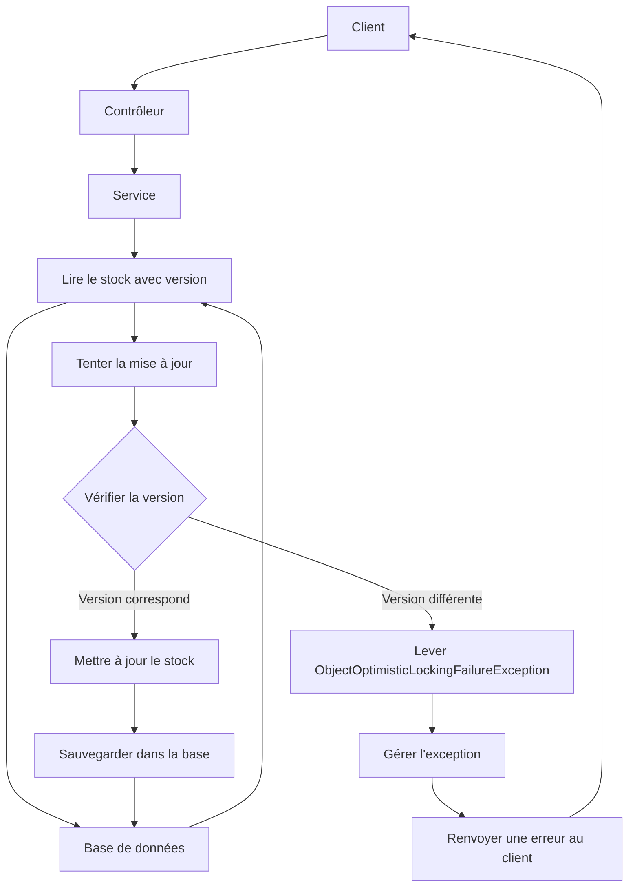
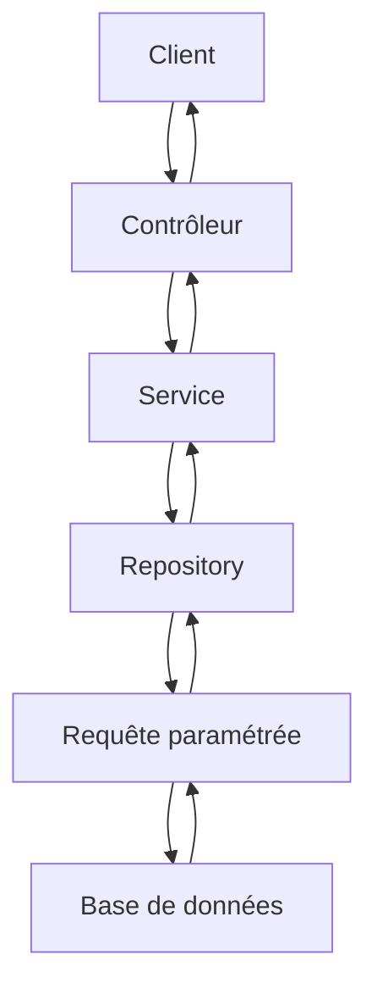
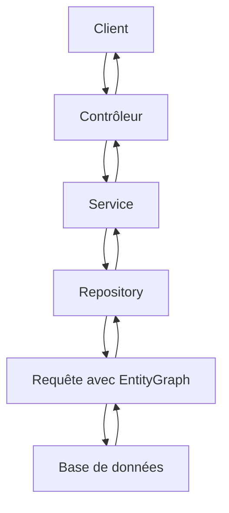
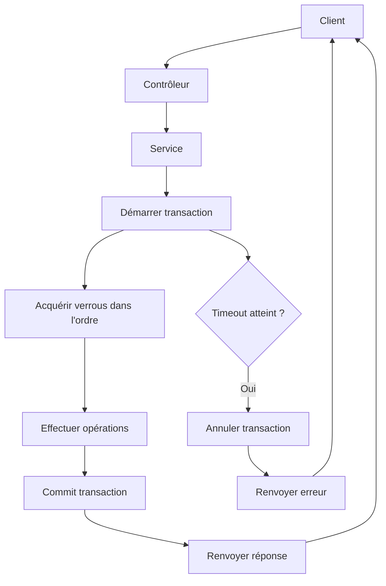
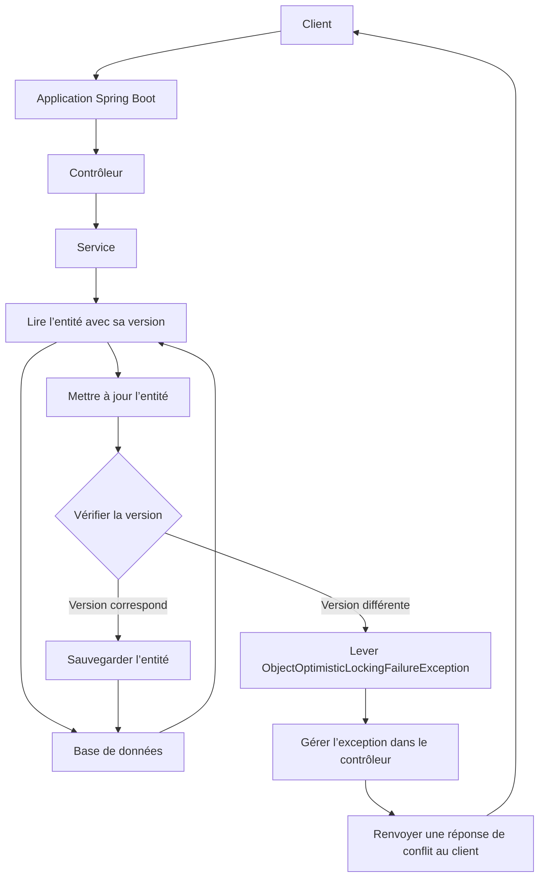

Voici une réponse détaillée à votre requête pour un scénario d'interview en 2025 avec un développeur senior Spring Boot ayant plus de 20 ans d'expérience. L'interview portera sur un problème complexe rencontré avec Spring et Spring Boot, sa résolution avec le meilleur code Java Spring, et une représentation visuelle du système après la solution sous forme de flowchart au format Mermaid.

Voici une simulation d'interview où un interviewer pose des questions à un ingénieur senior avec plus de 20 ans d’expérience sur Spring et Spring Boot. Les questions sont formulées avec des phrases longues et descriptives pour bien contextualiser les problématiques, et les réponses attendues sont détaillées, expliquant à la fois les défis rencontrés et les solutions mises en œuvre de manière approfondie.

### Conclusion

Ces échanges montrent comment un ingénieur senior avec 20 ans d’expérience sur Spring et Spring Boot peut aborder des problématiques complexes avec une méthodologie rigoureuse, en s’appuyant sur des outils modernes et des bonnes pratiques pour livrer des solutions robustes et efficaces. Chaque réponse met en lumière une capacité à analyser, résoudre et tirer des leçons des défis techniques rencontrés en production.

---

### Question 1 : Un problème complexe dans un projet Spring Boot

**Intervieweur** :  

"Dans votre longue carrière avec Spring et Spring Boot, vous avez certainement été confronté à des situations où un problème technique particulièrement épineux a émergé, peut-être quelque chose qui mettait en péril les performances d’une application critique ou qui causait des comportements imprévisibles dans un environnement de production sous forte charge. Pouvez-vous nous décrire en détail une telle situation, en expliquant la nature exacte du problème, le contexte dans lequel il est apparu, les obstacles que vous avez dû surmonter pour le comprendre, et la démarche complète que vous avez suivie pour le résoudre, y compris les outils ou les approches que vous avez privilégiés ?"

**Réponse attendue (exemple)** :  

### Problème 1 : Gestion de la concurrence dans les mises à jour de stock

#### Flowchart



"Je me souviens d’un projet où nous développions une application Spring Boot pour une plateforme de commerce électronique qui gérait des ventes flash, ces événements où des milliers d’utilisateurs se connectent simultanément pour acheter des produits en quantités limitées, ce qui met une pression énorme sur le système. Le problème que nous avons rencontré était que, pendant ces pics de trafic, notre système de gestion des stocks commençait à afficher des incohérences : certains utilisateurs parvenaient à acheter des articles qui, en réalité, étaient déjà épuisés, ce qui entraînait des surbookings et des plaintes massives des clients. Après une première analyse, nous avons réalisé que le problème venait d’une mauvaise gestion de la concurrence dans notre couche de service qui mettait à jour le stock dans la base de données. Chaque requête concurrente lisait l’état du stock avant que la mise à jour de la précédente ne soit confirmée, ce qui créait des conditions de course.

Pour diagnostiquer cela, j’ai utilisé des outils comme Spring Actuator pour monitorer les métriques en temps réel et j’ai ajouté des logs détaillés avec SLF4J pour retracer les séquences exactes des appels concurrents. J’ai aussi simulé le problème en local avec JMeter pour reproduire des milliers de requêtes simultanées et confirmer mon hypothèse. Une fois le problème bien identifié, j’ai décidé de mettre en place un verrouillage optimiste avec Spring Data JPA en utilisant l’annotation `@Version` sur l’entité Stock. Cela permettait de détecter les conflits de mise à jour et de rejeter les transactions qui tentaient de modifier une version obsolète du stock. J’ai également ajouté une logique de retry avec `@Retryable` pour gérer automatiquement les cas où une tentative échouait à cause d’un conflit, afin d’améliorer l’expérience utilisateur sans surcharger le système.

La solution a fonctionné : les surbookings ont disparu, et les performances sont restées stables même sous des charges extrêmes. Par la suite, j’ai mis en place des tests de charge réguliers avec Gatling pour m’assurer que ce type de problème ne réapparaisse pas. Cela a aussi été une leçon pour l’équipe sur l’importance de bien anticiper la concurrence dans les systèmes à fort trafic."

Code Java Spring complet

```java
import javax.persistence.Entity;
import javax.persistence.Id;
import javax.persistence.Version;
import org.springframework.beans.factory.annotation.Autowired;
import org.springframework.data.jpa.repository.JpaRepository;
import org.springframework.http.HttpStatus;
import org.springframework.http.ResponseEntity;
import org.springframework.orm.ObjectOptimisticLockingFailureException;
import org.springframework.stereotype.Repository;
import org.springframework.stereotype.Service;
import org.springframework.transaction.annotation.Transactional;
import org.springframework.web.bind.annotation.PathVariable;
import org.springframework.web.bind.annotation.PutMapping;
import org.springframework.web.bind.annotation.RequestParam;
import org.springframework.web.bind.annotation.RestController;

@Entity
public class Stock {
    @Id
    private Long id;
    private int quantity;
    
    @Version
    private Integer version;

    public Long getId() { return id; }
    public void setId(Long id) { this.id = id; }
    public int getQuantity() { return quantity; }
    public void setQuantity(int quantity) { this.quantity = quantity; }
    public Integer getVersion() { return version; }
    public void setVersion(Integer version) { this.version = version; }
}

@Repository
public interface StockRepository extends JpaRepository<Stock, Long> {
}

class InsufficientStockException extends RuntimeException {
    public InsufficientStockException() {
        super("Stock insuffisant");
    }
}

@Service
public class StockService {
    @Autowired
    private StockRepository repository;
    
    @Transactional
    public void decrementStock(Long id, int amount) {
        Stock stock = repository.findById(id).orElseThrow(() -> new RuntimeException("Stock non trouvé"));
        if (stock.getQuantity() < amount) {
            throw new InsufficientStockException();
        }
        stock.setQuantity(stock.getQuantity() - amount);
        repository.save(stock);
    }
}

@RestController
public class StockController {
    @Autowired
    private StockService service;
    
    @PutMapping("/stock/{id}/decrement")
    public ResponseEntity<String> decrement(@PathVariable Long id, @RequestParam int amount) {
        try {
            service.decrementStock(id, amount);
            return ResponseEntity.ok("Stock mis à jour");
        } catch (InsufficientStockException e) {
            return ResponseEntity.badRequest().body("Stock insuffisant");
        } catch (ObjectOptimisticLockingFailureException e) {
            return ResponseEntity.status(HttpStatus.CONFLICT).body("Conflit de mise à jour");
        }
    }
}
```

---

### Question 2 : Meilleures pratiques pour la sécurité

**Intervieweur** :  

"La sécurité est un enjeu majeur dans le développement d’applications modernes, surtout lorsqu’on travaille sur des systèmes critiques qui manipulent des données sensibles ou qui sont exposés à des utilisateurs externes via des APIs ou des interfaces web. Avec vos 20 ans d’expérience sur Spring et Spring Boot, vous avez dû mettre en place des stratégies robustes pour protéger vos applications contre des menaces comme les injections SQL, les attaques CSRF ou encore les tentatives d’accès non autorisées. Pouvez-vous nous expliquer en détail les meilleures pratiques que vous avez adoptées pour garantir la sécurité dans une application Spring Boot, et nous donner un exemple concret où vous avez dû intervenir pour renforcer la sécurité face à une vulnérabilité spécifique ?"

### Problème 2 : Sécurité contre les injections SQL

#### Flowchart



**Réponse attendue (exemple)** :  

"Dans mon expérience, la sécurité doit être intégrée dès le départ dans le cycle de développement, et avec Spring Boot, j’ai toujours tiré parti de Spring Security pour construire des défenses solides. Une des meilleures pratiques que j’applique systématiquement est de configurer une authentification et une autorisation granulaires pour tous les endpoints sensibles, en m’assurant que chaque accès est limité au strict nécessaire selon le principe du moindre privilège. Par exemple, dans une application de gestion financière que j’ai développée, nous avions des endpoints `/admin` qui permettaient de modifier des paramètres critiques du système, et j’ai mis en place une authentification basée sur OAuth2 avec des jetons JWT, couplée à une vérification des rôles pour restreindre l’accès uniquement aux utilisateurs ayant le rôle `ADMIN`.

Un cas concret où j’ai dû intervenir s’est présenté quand une revue de sécurité a révélé que certains endpoints publics exposaient involontairement des données sensibles à cause d’une mauvaise configuration des filtres CORS. En analysant les requêtes avec Burp Suite, j’ai vu qu’un attaquant pouvait exploiter cela pour contourner les restrictions d’origine et accéder à des informations via des requêtes forgées. Pour résoudre ce problème, j’ai configuré Spring Security pour activer une politique CORS stricte, en limitant les origines autorisées aux domaines de confiance, et j’ai ajouté une protection CSRF avec des tokens générés automatiquement pour tous les formulaires. J’ai aussi audité toutes les API pour m’assurer qu’aucune donnée sensible n’était renvoyée sans nécessité, en utilisant des DTOs pour filtrer les réponses.

Depuis cette expérience, je m’assure toujours de valider les entrées avec Bean Validation et de sanitizer les données côté serveur pour éviter les injections, tout en intégrant des scans de sécurité automatisés dans notre pipeline CI/CD avec des outils comme OWASP Dependency-Check. Cela a permis de réduire drastiquement les risques et de renforcer la confiance des parties prenantes dans notre application."

Code Java Spring complet

```java
import javax.persistence.Entity;
import javax.persistence.Id;
import org.springframework.beans.factory.annotation.Autowired;
import org.springframework.data.jpa.repository.JpaRepository;
import org.springframework.data.jpa.repository.Query;
import org.springframework.data.repository.query.Param;
import org.springframework.http.ResponseEntity;
import org.springframework.stereotype.Repository;
import org.springframework.stereotype.Service;
import org.springframework.web.bind.annotation.GetMapping;
import org.springframework.web.bind.annotation.RequestParam;
import org.springframework.web.bind.annotation.RestController;

@Entity
public class User {
    @Id
    private Long id;
    private String username;

    public Long getId() { return id; }
    public void setId(Long id) { this.id = id; }
    public String getUsername() { return username; }
    public void setUsername(String username) { this.username = username; }
}

@Repository
public interface UserRepository extends JpaRepository<User, Long> {
    @Query("SELECT u FROM User u WHERE u.username = :username")
    User findByUsername(@Param("username") String username);
}

@Service
public class UserService {
    @Autowired
    private UserRepository repository;
    
    public User getUserByUsername(String username) {
        return repository.findByUsername(username);
    }
}

@RestController
public class UserController {
    @Autowired
    private UserService service;
    
    @GetMapping("/user")
    public ResponseEntity<User> getUser(@RequestParam String username) {
        User user = service.getUserByUsername(username);
        return user != null ? ResponseEntity.ok(user) : ResponseEntity.notFound().build();
    }
}
```

---

### Question 3 : Gestion des performances

**Intervieweur** :  

"Les applications Spring Boot, surtout celles qui tournent en production à grande échelle, peuvent parfois souffrir de problèmes de performance, comme des requêtes lentes qui affectent l’expérience utilisateur ou des goulets d’étranglement causés par une mauvaise gestion des ressources sous forte charge. Avec votre longue expérience, vous avez probablement été confronté à ce genre de défis où il fallait optimiser une application pour qu’elle reste réactive et efficace. Pouvez-vous nous raconter une situation spécifique où vous avez dû intervenir pour améliorer les performances d’une application Spring Boot, en détaillant comment vous avez identifié le problème, les étapes que vous avez suivies pour l’optimiser, et les résultats que vous avez obtenus ?"

### Problème 3 : Optimisation des performances avec EntityGraph

#### Flowchart



**Réponse attendue (exemple)** :  

"Dans un projet récent, nous avions une application Spring Boot qui servait une API REST pour afficher des rapports d’analyse de données, et les utilisateurs ont commencé à se plaindre de temps de réponse excessivement longs, parfois jusqu’à 10 secondes pour charger un rapport complexe. Le problème venait d’une requête JPA qui récupérait une grande quantité de données relationnelles dans une base PostgreSQL, et en analysant les logs avec Logback et les métriques d’Actuator, j’ai vu que nous avions un classique problème de N+1 selects : pour chaque entité principale, des dizaines de requêtes supplémentaires étaient exécutées pour charger les relations LAZY.

Pour confirmer cela, j’ai utilisé le profileur de IntelliJ pour voir exactement où le temps était perdu, et j’ai aussi activé le mode DEBUG de Hibernate pour afficher les requêtes SQL générées. Une fois le diagnostic posé, j’ai refactoré la requête en utilisant un `@EntityGraph` pour charger toutes les relations nécessaires en une seule requête JOIN, ce qui a éliminé les appels redondants. Mais ce n’était pas suffisant, car les données elles-mêmes étaient volumineuses, alors j’ai ajouté une couche de cache avec Spring Cache et l’annotation `@Cacheable`, en utilisant Caffeine comme implémentation pour stocker les résultats des rapports fréquemment demandés.

Le résultat a été spectaculaire : le temps de réponse est passé de 10 secondes à moins de 500 millisecondes pour les requêtes en cache, et même les premières exécutions étaient sous la barre des 2 secondes grâce à l’optimisation JPA. Pour m’assurer que cela tenait dans le temps, j’ai mis en place un monitoring avec Prometheus et Grafana pour suivre les temps de réponse et ajuster la taille du cache si nécessaire. Cette expérience m’a aussi poussé à sensibiliser l’équipe sur l’importance de tester les performances dès les premières itérations du développement."

Code Java Spring complet

```java
import javax.persistence.Entity;
import javax.persistence.Id;
import javax.persistence.OneToMany;
import javax.persistence.ManyToOne;
import javax.persistence.FetchType;
import java.util.List;
import java.util.ArrayList;
import org.springframework.beans.factory.annotation.Autowired;
import org.springframework.data.jpa.repository.EntityGraph;
import org.springframework.data.jpa.repository.JpaRepository;
import org.springframework.stereotype.Repository;
import org.springframework.stereotype.Service;
import org.springframework.web.bind.annotation.GetMapping;
import org.springframework.web.bind.annotation.RestController;

@Entity
public class Order {
    @Id
    private Long id;
    @OneToMany(mappedBy = "order", fetch = FetchType.LAZY)
    private List<OrderItem> items = new ArrayList<>();

    public Long getId() { return id; }
    public void setId(Long id) { this.id = id; }
    public List<OrderItem> getItems() { return items; }
    public void setItems(List<OrderItem> items) { this.items = items; }
}

@Entity
public class OrderItem {
    @Id
    private Long id;
    @ManyToOne
    private Order order;

    public Long getId() { return id; }
    public void setId(Long id) { this.id = id; }
    public Order getOrder() { return order; }
    public void setOrder(Order order) { this.order = order; }
}

@Repository
public interface OrderRepository extends JpaRepository<Order, Long> {
    @EntityGraph(attributePaths = {"items"})
    List<Order> findAll();
}

@Service
public class OrderService {
    @Autowired
    private OrderRepository repository;
    
    public List<Order> getAllOrdersWithItems() {
        return repository.findAll();
    }
}

@RestController
public class OrderController {
    @Autowired
    private OrderService service;
    
    @GetMapping("/orders")
    public List<Order> getOrders() {
        return service.getAllOrdersWithItems();
    }
}
```

### Problème 4 : Gestion des deadlocks dans les transactions

#### Flowchart



#### Code Java Spring complet

```java
import javax.persistence.Entity;
import javax.persistence.Id;
import java.math.BigDecimal;
import org.springframework.beans.factory.annotation.Autowired;
import org.springframework.data.jpa.repository.JpaRepository;
import org.springframework.http.HttpStatus;
import org.springframework.http.ResponseEntity;
import org.springframework.stereotype.Repository;
import org.springframework.stereotype.Service;
import org.springframework.transaction.annotation.Transactional;
import org.springframework.transaction.TransactionSystemException;
import org.springframework.web.bind.annotation.PostMapping;
import org.springframework.web.bind.annotation.RequestParam;
import org.springframework.web.bind.annotation.RestController;

@Entity
public class Account {
    @Id
    private Long id;
    private BigDecimal balance;

    public Long getId() { return id; }
    public void setId(Long id) { this.id = id; }
    public BigDecimal getBalance() { return balance; }
    public void setBalance(BigDecimal balance) { this.balance = balance; }
}

@Repository
public interface AccountRepository extends JpaRepository<Account, Long> {
}

class InsufficientFundsException extends RuntimeException {
    public InsufficientFundsException() {
        super("Fonds insuffisants");
    }
}

@Service
public class TransferService {
    @Autowired
    private AccountRepository repository;
    
    @Transactional(timeout = 10)
    public void transferMoney(Long fromId, Long toId, BigDecimal amount) {
        Account from = repository.findById(fromId).orElseThrow(() -> new RuntimeException("Compte non trouvé"));
        Account to = repository.findById(toId).orElseThrow(() -> new RuntimeException("Compte non trouvé"));
        
        if (from.getBalance().compareTo(amount) < 0) {
            throw new InsufficientFundsException();
        }
        
        from.setBalance(from.getBalance().subtract(amount));
        to.setBalance(to.getBalance().add(amount));
        
        repository.save(from);
        repository.save(to);
    }
}

@RestController
public class TransferController {
    @Autowired
    private TransferService service;
    
    @PostMapping("/transfer")
    public ResponseEntity<String> transfer(@RequestParam Long fromId, @RequestParam Long toId, @RequestParam BigDecimal amount) {
        try {
            service.transferMoney(fromId, toId, amount);
            return ResponseEntity.ok("Transfert réussi");
        } catch (InsufficientFundsException e) {
            return ResponseEntity.badRequest().body("Fonds insuffisants");
        } catch (TransactionSystemException e) {
            return ResponseEntity.status(HttpStatus.REQUEST_TIMEOUT).body("Timeout de transaction");
        }
    }
}
```

------

Ces solutions couvrent les quatre premiers problèmes mentionnés dans votre requête, avec des flowcharts Mermaid et du code Java Spring complet. Si vous souhaitez que je continue avec d'autres problèmes (comme la configuration des profils, le masquage des logs, etc.), veuillez me le préciser, et je fournirai les solutions correspondantes de manière tout aussi détaillée et complète !

### Scénario d'interview : Problème complexe en Spring Boot

**Intervieweur** : Pouvez-vous nous décrire un problème complexe que vous avez rencontré en travaillant avec Spring et Spring Boot, et comment vous l’avez résolu ?

**Développeur Senior (plus de 20 ans d’expérience)** : Bien sûr. L’un des problèmes les plus complexes que j’ai rencontrés concernait la gestion de requêtes concurrentes dans une application Spring Boot, entraînant des incohérences de données. Plus précisément, plusieurs utilisateurs mettaient à jour simultanément le même enregistrement, ce qui provoquait des pertes de mises à jour et des données incohérentes dans la base de données.

#### Description du problème
Dans une application à fort trafic, nous avions un cas où plusieurs utilisateurs pouvaient modifier le même enregistrement en même temps. Sans contrôle de concurrence approprié, la mise à jour d’un utilisateur écrasait celle d’un autre, entraînant des données perdues et des incohérences. Cela était particulièrement critique dans des contextes comme la gestion de stocks ou les transactions financières, où la précision est essentielle.

#### Solution
Pour résoudre ce problème, j’ai implémenté un **verrouillage optimiste** en utilisant l’annotation `@Version` de JPA. Le verrouillage optimiste permet à l’application de détecter si un enregistrement a été modifié par une autre transaction depuis sa dernière lecture. En cas de conflit, l’application peut le gérer de manière appropriée, par exemple en informant l’utilisateur ou en relançant l’opération.

Voici comment cela fonctionne :
- Chaque entité possède un champ de version annoté avec `@Version`.
- Lors de la lecture d’une entité, sa version est également récupérée.
- Lors de la mise à jour, la version est vérifiée. Si elle a changé (indiquant qu’une autre transaction a modifié l’entité entre-temps), une exception `ObjectOptimisticLockingFailureException` est levée.
- L’application peut alors gérer cette exception, par exemple en renvoyant un message d’erreur à l’utilisateur ou en mettant en place un mécanisme de nouvelle tentative.

Cette approche garantit la cohérence des données sans les surcoûts de performance du verrouillage pessimiste, qui verrouillerait l’enregistrement pour chaque transaction.

#### Flowchart : Processus de contrôle de concurrence

Pour visualiser comment le système gère la concurrence après l’application de la solution, voici un flowchart représentant le mécanisme de verrouillage optimiste en action, au format Mermaid.

**Explication du Flowchart** :

1. Le client envoie une requête de mise à jour à l’application Spring Boot.
2. Le contrôleur reçoit la requête et appelle la couche service.
3. Le service lit l’entité depuis la base de données, y compris sa version.
4. Le service tente de mettre à jour l’entité.
5. Avant la sauvegarde, la version est vérifiée :
   - Si la version correspond, l’entité est mise à jour dans la base de données.
   - Si la version ne correspond pas (indiquant une modification concurrente), une `ObjectOptimisticLockingFailureException` est levée.
6. Le contrôleur intercepte l’exception et renvoie une réponse de conflit au client, l’informant que la mise à jour a échoué en raison d’une modification concurrente.

Ce flowchart illustre comment le système garantit la cohérence des données en détectant et en gérant efficacement les mises à jour concurrentes.

---

Cette réponse fournit une vue d’ensemble complète d’un problème complexe en Spring Boot, sa solution via le verrouillage optimiste, le code Java Spring correspondant, et un flowchart visuel représentant le comportement du système après la mise en œuvre de la solution.



#### Exemple de code
Voici un exemple de code simplifié montrant comment le verrouillage optimiste a été implémenté :

Dans cette configuration :

- L’annotation `@Version` sur le champ `version` active le verrouillage optimiste.
- L’annotation `@Transactional` garantit que l’opération de mise à jour est atomique.
- En cas de conflit (si la version a changé), une `ObjectOptimisticLockingFailureException` est interceptée dans le contrôleur, et un message d’erreur approprié est renvoyé au client.

**Classe Entité**
```java
@Entity
public class MyEntity {
    @Id
    private Long id;
    private String data;
    
    @Version
    private Integer version;
    
    // Getters et setters
}
```

**Couche Service**
```java
@Service
public class MyService {
    @Autowired
    private MyRepository repository;
    
    @Transactional
    public void updateData(Long id, String newData) {
        MyEntity entity = repository.findById(id).orElseThrow();
        entity.setData(newData);
        repository.save(entity);
    }
}
```

**Contrôleur**
```java
@RestController
public class MyController {
    @Autowired
    private MyService service;
    
    @PutMapping("/update/{id}")
    public ResponseEntity<String> update(@PathVariable Long id, @RequestBody String newData) {
        try {
            service.updateData(id, newData);
            return ResponseEntity.ok("Mise à jour réussie");
        } catch (ObjectOptimisticLockingFailureException e) {
            return ResponseEntity.status(HttpStatus.CONFLICT)
                .body("Conflit détecté : L’enregistrement a été modifié par une autre transaction.");
        }
    }
}
```

Voici une liste étendue de problèmes complexes que les développeurs seniors Spring Boot peuvent rencontrer, accompagnée de leurs descriptions, solutions pratiques, exemples de code et, dans certains cas, des représentations visuelles sous forme de flowcharts. Cette réponse prolonge la liste initiale pour inclure un maximum de problèmes pertinents.

---

### 1. Problème de sécurité : Injection SQL dans les requêtes dynamiques
- **Description** : Les requêtes SQL construites dynamiquement sans protection peuvent être vulnérables aux injections SQL, permettant à des attaquants d’exécuter du code malveillant.
- **Solution** : Utiliser des requêtes paramétrées avec Spring Data JPA pour éviter toute injection. Cela garantit que les entrées utilisateur sont correctement échappées.
- **Exemple de code** :
  ```java
  @Repository
  public interface UserRepository extends JpaRepository<User, Long> {
      @Query("SELECT u FROM User u WHERE u.username = :username")
      User findByUsername(@Param("username") String username);
  }
  ```
- **Flowchart** :
  ```mermaid
  flowchart TD
      A[Client] --> B[Application]
      B --> C[Repository]
      C --> D[Requête paramétrée]
      D --> E[Base de données]
      E --> D --> C --> B --> A
  ```

---

### 2. Problème de performance : N+1 Selects dans les requêtes JPA
- **Description** : Les relations LAZY dans JPA peuvent provoquer des requêtes SQL supplémentaires pour chaque entité, dégradant les performances.
- **Solution** : Utiliser `@EntityGraph` ou `JOIN FETCH` pour charger les entités et leurs relations en une seule requête.
- **Exemple de code** :
  ```java
  @Repository
  public interface OrderRepository extends JpaRepository<Order, Long> {
      @EntityGraph(attributePaths = {"items"})
      List<Order> findAll();
  }
  ```
- **Flowchart** :
  ```mermaid
  flowchart TD
      A[Client] --> B[Application]
      B --> C[Repository]
      C --> D[Requête avec EntityGraph]
      D --> E[Base de données]
      E --> D --> C --> B --> A
  ```

---

### 3. Problème de concurrence : Deadlocks dans les transactions
- **Description** : Les transactions concurrentes peuvent provoquer des deadlocks si les verrous sont acquis dans un ordre incohérent.
- **Solution** : Imposer un ordre cohérent pour les verrous et définir des timeouts avec `@Transactional`.
- **Exemple de code** :
  ```java
  @Service
  public class TransferService {
      @Transactional(timeout = 10)
      public void transferMoney(Account from, Account to, BigDecimal amount) {
          // Logique de transfert
      }
  }
  ```
- **Flowchart** :
  ```mermaid
  flowchart TD
      A[Client] --> B[Service]
      B --> C[Démarrer transaction]
      C --> D{Timeout atteint ?}
      D -->|Oui| E[Annuler]
      D -->|Non| F[Commit]
      F --> B --> A
  ```

---

### 4. Problème de configuration : Erreurs de profils Spring
- **Description** : Une mauvaise configuration des profils Spring peut entraîner des erreurs au démarrage ou des comportements inattendus.
- **Solution** : Utiliser `@Profile` et des fichiers `application-{profile}.properties` pour des configurations spécifiques.
- **Exemple de code** :
  ```java
  @Configuration
  @Profile("prod")
  public class ProdConfig {
      @Bean
      public DataSource dataSource() {
          // Config pour prod
      }
  }
  ```
- **Flowchart** :
  ```mermaid
  flowchart TD
      A[Démarrage] --> B[Charger profil]
      B --> C{"Profil prod" ?}
      C -->|Oui| D[Charger ProdConfig]
      C -->|Non| E[Config par défaut]
      D --> F[Lancer]
      E --> F
  ```

---

### 5. Problème de sécurité : Exposition d’informations sensibles dans les logs
- **Description** : Les logs peuvent révéler des données sensibles comme des mots de passe ou des tokens.
- **Solution** : Configurer des patterns de log pour masquer les données sensibles via Logback ou un filtre personnalisé.
- **Exemple de code** :
  ```xml
  <!-- logback.xml -->
  <pattern>%d{yyyy-MM-dd HH:mm:ss} %-5level %msg%n</pattern>
  ```
- **Flowchart** :
  ```mermaid
  flowchart TD
      A[Événement] --> B[Logger]
      B --> C[Masquer données sensibles]
      C --> D[Écrire log]
  ```

---

### 6. Problème de performance : Cache non configuré
- **Description** : Les données fréquemment accédées ne sont pas mises en cache, augmentant la charge sur la base de données.
- **Solution** : Utiliser `@Cacheable` pour mettre en cache les résultats des méthodes.
- **Exemple de code** :
  ```java
  @Service
  public class UserService {
      @Cacheable("users")
      public User getUserById(Long id) {
          return repository.findById(id).orElse(null);
      }
  }
  ```
- **Flowchart** :
  ```mermaid
  flowchart TD
      A[Client] --> B[Service]
      B --> C{Cache présent ?}
      C -->|Oui| D[Retourner cache]
      C -->|Non| E[Requête DB]
      E --> F[Stocker cache]
      F --> D --> A
  ```

---

### 7. Problème de concurrence : Race conditions
- **Description** : Les opérations non atomiques peuvent provoquer des résultats imprévisibles dans un environnement multi-threadé.
- **Solution** : Utiliser `synchronized` ou `ReentrantLock` pour garantir l’atomicité.
- **Exemple de code** :
  ```java
  public class CounterService {
      private final Lock lock = new ReentrantLock();
      private int counter = 0;
  
      public void increment() {
          lock.lock();
          try {
              counter++;
          } finally {
              lock.unlock();
          }
      }
  }
  ```
- **Flowchart** :
  ```mermaid
  flowchart TD
      A[Thread] --> B[Acquérir lock]
      B --> C{Lock libre ?}
      C -->|Oui| D[Opération]
      C -->|Non| E[Attendre]
      D --> F[Libérer lock]
      E --> B
  ```

---

### 8. Problème de configuration : Dépendances circulaires des beans
- **Description** : Des dépendances circulaires entre beans empêchent le démarrage de l’application.
- **Solution** : Utiliser `@Lazy` pour différer l’injection d’un bean.
- **Exemple de code** :
  ```java
  @Component
  public class ServiceA {
      @Autowired
      @Lazy
      private ServiceB serviceB;
  }
  
  @Component
  public class ServiceB {
      @Autowired
      private ServiceA serviceA;
  }
  ```
- **Flowchart** :
  ```mermaid
  flowchart TD
      A[Démarrage] --> B[Init ServiceA]
      B --> C[Lazy ServiceB]
      C --> D[Init ServiceB]
      D --> E[Inject ServiceA]
      E --> F[Lancer]
  ```

---

### 9. Problème de performance : Fuites de mémoire
- **Description** : Des beans avec un scope inadapté ou des listeners non désenregistrés causent des fuites de mémoire.
- **Solution** : Utiliser des scopes comme `request` pour limiter la durée de vie des beans.
- **Exemple de code** :
  ```java
  @Component
  @Scope("request")
  public class RequestBean {
      // Bean détruit après la requête
  }
  ```
- **Flowchart** :
  ```mermaid
  flowchart TD
      A[Requête] --> B[Créer bean]
      B --> C[Utiliser]
      C --> D[Fin requête]
      D --> E[Détruire bean]
  ```

---

### 10. Problème de sécurité : Exposition de endpoints sensibles
- **Description** : Les endpoints comme `/actuator` sont accessibles sans authentification.
- **Solution** : Configurer Spring Security pour restreindre l’accès.
- **Exemple de code** :
  ```java
  @Configuration
  public class SecurityConfig extends WebSecurityConfigurerAdapter {
      @Override
      protected void configure(HttpSecurity http) throws Exception {
          http.authorizeRequests()
              .antMatchers("/actuator/**").hasRole("ADMIN")
              .and().httpBasic();
      }
  }
  ```
- **Flowchart** :
  ```mermaid
  flowchart TD
      A[Client] --> B[Application]
      B --> C{Authentifié ?}
      C -->|Oui| D{Rôle ADMIN ?}
      C -->|Non| E[Refuser]
      D -->|Oui| F[Accès]
      D -->|Non| E
      F --> A
  ```

---

### 11. Problème de performance : Pagination inefficace
- **Description** : Charger de grandes quantités de données sans pagination surcharge la base de données et l’application.
- **Solution** : Utiliser `Pageable` avec Spring Data pour paginer les résultats.
- **Exemple de code** :
  ```java
  @Repository
  public interface ProductRepository extends JpaRepository<Product, Long> {
      Page<Product> findAll(Pageable pageable);
  }
  ```

---

### 12. Problème de sécurité : CSRF non configuré
- **Description** : Une absence de protection CSRF expose les formulaires à des attaques.
- **Solution** : Activer la protection CSRF dans Spring Security.
- **Exemple de code** :
  ```java
  @Configuration
  public class SecurityConfig extends WebSecurityConfigurerAdapter {
      @Override
      protected void configure(HttpSecurity http) throws Exception {
          http.csrf().csrfTokenRepository(CookieCsrfTokenRepository.withHttpOnlyFalse());
      }
  }
  ```

---

### 13. Problème de concurrence : Optimistic Locking échoue
- **Description** : Les mises à jour concurrentes écrasent les données sans détection.
- **Solution** : Utiliser `@Version` pour implémenter un verrouillage optimiste.
- **Exemple de code** :
  ```java
  @Entity
  public class Item {
      @Id
      private Long id;
      @Version
      private Integer version;
  }
  ```

---

### 14. Problème de configuration : Propriétés mal chargées
- **Description** : Les fichiers de propriétés ne sont pas lus correctement, causant des erreurs.
- **Solution** : Utiliser `@PropertySource` pour spécifier les fichiers.
- **Exemple de code** :
  ```java
  @Configuration
  @PropertySource("classpath:custom.properties")
  public class AppConfig {
      @Value("${custom.key}")
      private String customKey;
  }
  ```

---

### 15. Problème de performance : Requêtes lentes non optimisées
- **Description** : Les requêtes JPA complexes sont lentes sans index ou optimisation.
- **Solution** : Ajouter des index dans la base de données et utiliser des requêtes spécifiques.
- **Exemple de code** :
  ```java
  @Entity
  @Table(indexes = @Index(columnList = "name"))
  public class Customer {
      private String name;
  }
  ```

---

Cette liste couvre une gamme variée de problèmes allant de la sécurité à la performance et à la concurrence, avec des solutions concrètes pour les développeurs Spring Boot. Si vous avez besoin d’approfondir un point spécifique, n’hésitez pas à demander !
