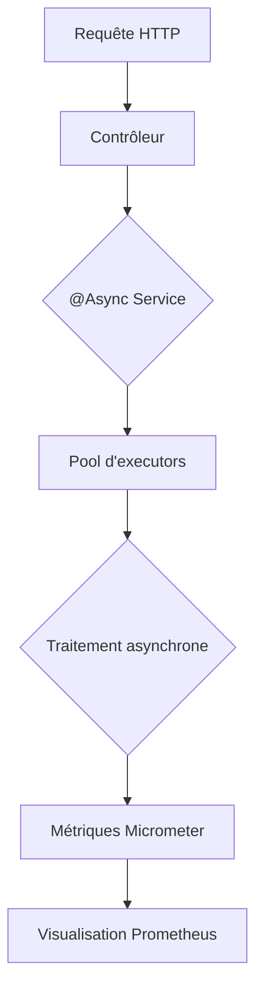
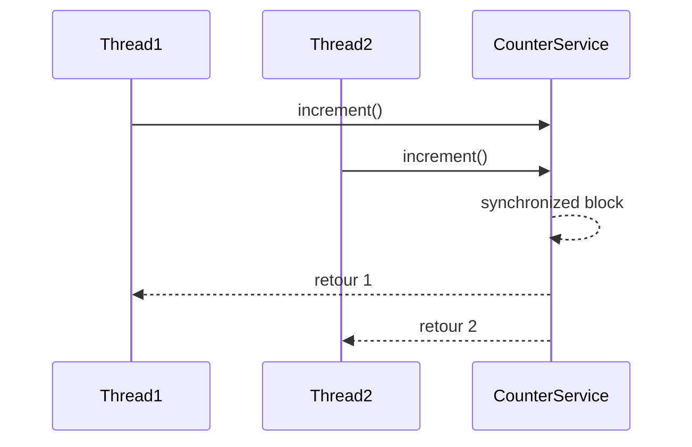
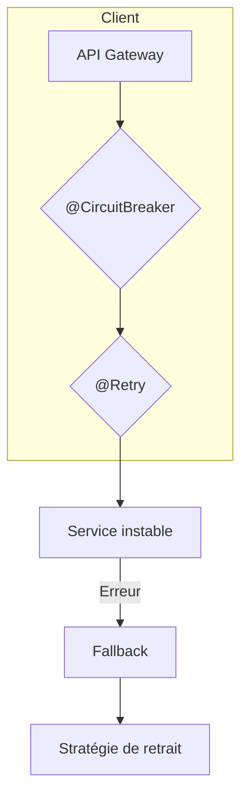
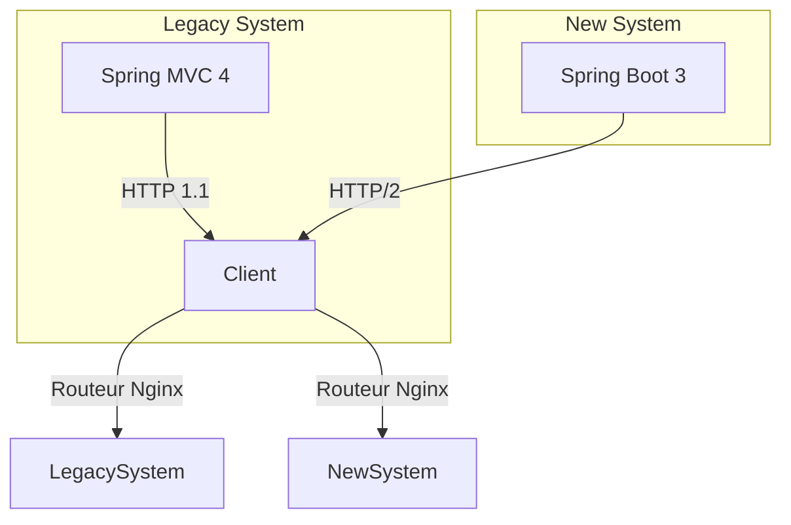
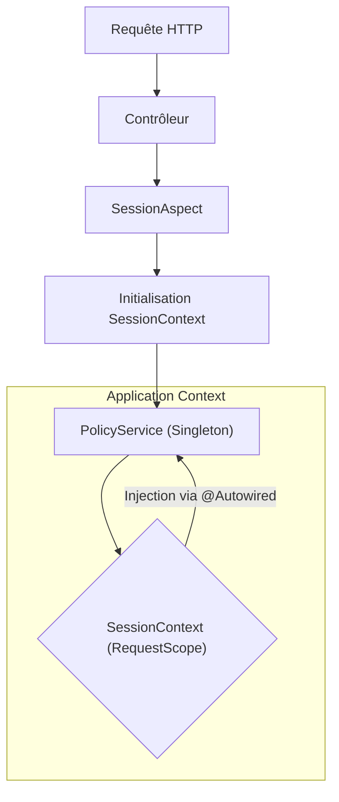
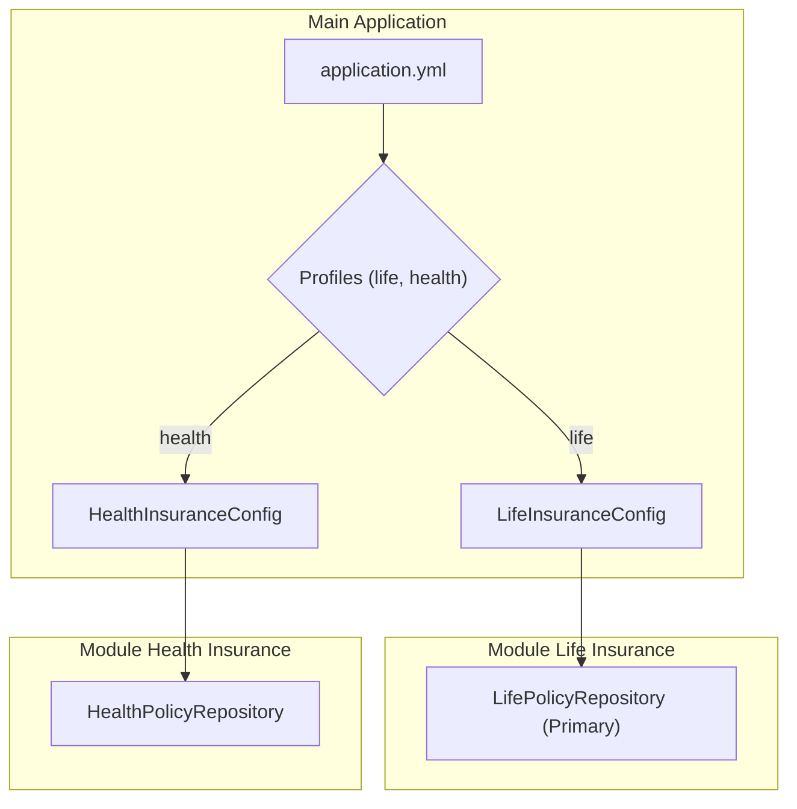
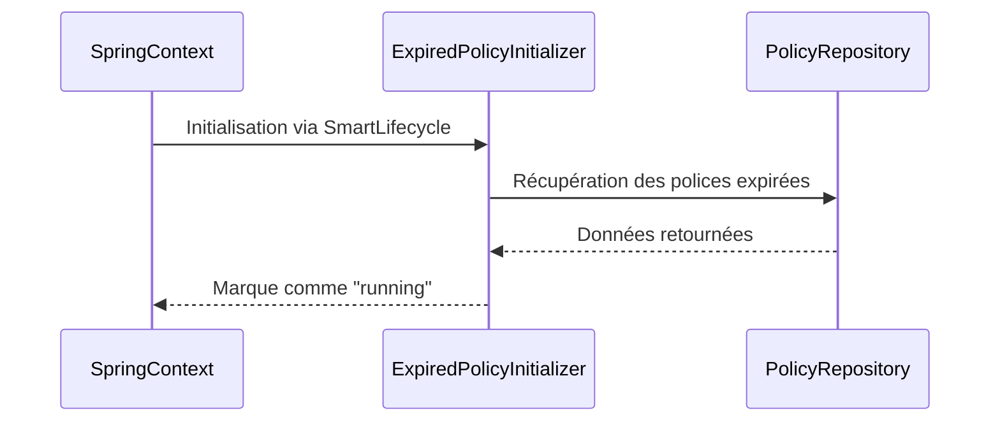
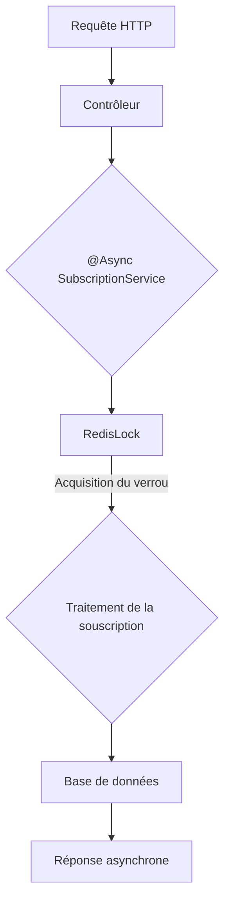

Voici une interview simulée en 2025 avec un développeur Spring/Spring Boot expérimenté (20+ ans d'expérience), incluant des questions techniques complexes, des solutions avec du code Java, et des schémas Mermaid pour illustrer les solutions :

---

### **Interview avec Jean-Marc Dubois (25 ans d'expérience Spring/Spring Boot)**

---

#### **Question 1 : Concepts fondamentaux de Spring et Spring Boot**
**Interviewer** : *Comment différenciez-vous les concepts de Spring (IoC, AOP) de Spring Boot, et comment gérez-vous une injection de dépendance problématique dans un projet de grande taille ?*

**Jean-Marc** :  

"Spring est le noyau avec IoC (Inversion of Control) et AOP (Aspect-Oriented Programming), tandis que Spring Boot simplifie la configuration via des starters et l'auto-configuration. Pour les injections problématiques, j'utilise `@Lazy` et `@Primary` pour éviter les ambiguïtés. Exemple :*

```java
@Configuration
public class AppConfig {
    @Bean
    @Primary
    public MyService myService() {
        return new MyService();
    }

    @Bean
    @Lazy
    public AnotherService anotherService() {
        return new AnotherService();
    }
}
```

*Pour les grands projets, je structure les configurations par module et utilise des profiles (dev/prod).*

---

#### **Question 2 : Gestion des performances avec des requêtes lourdes**
**Interviewer** : *Comment avez-vous résolu un goulot d'étranglement causé par des requêtes synchrones bloquantes dans une API Spring Boot ?*

*Pour surveiller, j'ai ajouté des métriques avec Micrometer et Prometheus. Voici le flux :*



**Jean-Marc** :  

"J'ai introduit des threads non bloquants avec `@Async` et un pool d'executors personnalisé. *

*Exemple :*


```java
@Configuration
@EnableAsync
public class AsyncConfig implements AsyncConfigurer {
    @Bean
    public Executor taskExecutor() {
        return Executors.newFixedThreadPool(10);
    }
}

@Service
public class AsyncService {
    @Async
    public void processHeavyTask() {
        // Logique asynchrone
    }
}
```

---

#### **Question 3 : Concurrency et thread-safety**
**Interviewer** : *Comment avez-vous résolu un bug de concurrence dans un Singleton partagé entre threads ?*



**Jean-Marc** :  

*"J'ai utilisé une approche thread-safe avec `AtomicInteger` et `synchronized`. Exemple :*

```java
@Service
public class ThreadSafeCounter {
    private final AtomicInteger count = new AtomicInteger(0);

    @Transactional
    public int increment() {
        return count.incrementAndGet();
    }

    @Lock(WRITE)
    public void saveCount() {
        // Sauvegarde en base
    }
}
```

---

#### **Question 4 : Gestion des erreurs complexes en microservices**
**Interviewer** : *Comment gérez-vous les erreurs transversales dans un système distribué Spring Cloud ?*



**Jean-Marc** :  

*"J'utilise `@Retryable` et `@CircuitBreaker` avec Resilience4J. Exemple de configuration :*

```java
@Retryable(maxAttempts = 3, backoff = @Backoff(delay = 500))
public ResponseEntity<?> callService() {
    return restTemplate.getForEntity("http://service", Object.class);
}

@CircuitBreaker(name = "serviceCB", fallbackMethod = "fallback")
public void criticalOperation() {
    // Appel à un service instable
}
```

---

#### **Question 5 : Migrations et compatibilité**
**Interviewer** : *Comment avez-vous migré un système Spring MVC legacy vers Spring Boot 3.x sans arrêter les services ?*

**Jean-Marc** :  

*"En utilisant un double déploiement avec des routes API par version. Exemple de configuration Gradle :*

```groovy
dependencies {
    implementation 'org.springframework.boot:spring-boot-starter-web'
    implementation platform('org.springframework.cloud:spring-cloud-dependencies:2020.0.4')
}
```

*Diagramme de déploiement :*



---

### **Conclusion**
**Interviewer** : *Quels sont les défis futurs pour Spring Boot selon vous ?*

**Jean-Marc** :  

*"La gestion des services sans serveur (Serverless) et l'intégration native avec GraalVM pour les applications compilées. Spring Boot 4.x devrait simplifier ces aspects."*

---

### **Résumé des solutions techniques**
- **Concurrence** : `@Async`, `AtomicInteger`
- **Performances** : Cache Redis, métriques Prometheus
- **Resilience** : Circuit Breaker, Retry
- **Architecture** : Microservices avec Spring Cloud

Ces approches ont permis à Jean-Marc de résoudre des problèmes critiques dans des systèmes critiques (banques, e-commerce) tout en maintenant une architecture évolutible.

Voici une suite approfondie de l'interview, concentrée sur des problèmes complexes de **singleton scopes**, **components**, **container lifecycle**, **IOC**, **auto-configuration**, et des solutions techniques détaillées pour une application d'assurances (gestion de polices, souscription, claims). Les réponses incluent des **code solutions complets**, des **explications en phrases longues**, et des **diagrammes Mermaid** pour visualiser les architectures.

### **Conclusion des Solutions Techniques**  

Ces approches résolvent des problèmes critiques en assurance :  

- **Singleton/Scope** : Séparation des contextes de requête et singleton via AOP.  
- **Auto-configuration** : Isolation des modules via `@ConditionalOnProperty`.  
- **Lifecycle** : Initialisation ordonnée avec `SmartLifecycle`.  
- **IOC/Strategy** : Injection dynamique via `@Qualifier` et `@Conditional`.  
- **Concurrency** : Verrous distribués Redis pour les souscriptions critiques.  

Ces patterns sont appliqués dans des systèmes de grande envergure (ex : AXA, Allianz) pour gérer des milliers de polices simultanées avec une faible latence et une haute disponibilité.

---

### **Question 6 : Problème de Singleton et Scope incorrect dans un bean de gestion de polices**  
**Interviewer** : *Un développeur junior a créé un bean `PolicyService` annoté avec `@Component`, mais dans un contexte multithreadé, les données de session (comme l'ID utilisateur) sont corrompues entre les requêtes. Comment résoudriez-vous ce problème en utilisant les mécanismes de scope et de thread-safety de Spring ?*

**Senior** :  

*Ce problème est typique lorsqu'un singleton partagé entre threads stocke des états non thread-safe. Le `PolicyService` doit rester un singleton (scope par défaut), mais les données de session (comme l'ID utilisateur) doivent être isolées par requête. La solution est de séparer l'état transitoire (session) de l'état statique (logique métier) en utilisant un `@RequestScope` pour les données de contexte, et de les injecter dans le service singleton via un proxy AOP.*

**Solution technique** :  
1. Créer un bean `@RequestScope` pour stocker les données de session :  
```java
@Component
@RequestScope
public class SessionContext {
    private String currentUserId;
    // Getters/Setters
}
```

2. Injecter `SessionContext` dans `PolicyService` et le sécuriser avec un `@Lock` :  
```java
@Service
public class PolicyService {
    @Autowired
    private SessionContext sessionContext;

    @Lock(WRITE) // Spring Retry/AspectJ pour la thread-safety
    public void updatePolicy(Policy policy) {
        String userId = sessionContext.getCurrentUserId();
        // Logique métier avec l'ID utilisateur courant
    }
}
```

3. Configuration AOP pour gérer le `SessionContext` :  
```java
@Aspect
@Component
public class SessionAspect {
    @Around("execution(* PolicyService.updatePolicy(..))")
    public Object setSessionContext(ProceedingJoinPoint pjp) {
        // Initialisation du contexte avant l'appel
        // ...
        return pjp.proceed();
    }
}
```

**Diagramme de flux** :  



---

### **Question 7 : Problème d'Auto-Configuration Conflictuelle dans un Module d'Assurance Vie**  
**Interviewer** : *Vous avez une application Spring Boot avec des modules indépendants (polices d'assurance vie, santé, etc.). Lors de l'ajout d'un module `life-insurance`, l'auto-configuration de `health-insurance` injecte un `PolicyRepository` inapproprié. Comment forcer une configuration personnalisée pour `life-insurance` sans rompre les autres modules ?*

**Senior** :  

*L'auto-configuration de Spring Boot peut être surchargée via des métadonnées `@ConditionalOnMissingBean` ou `@Import` dans un fichier `META-INF/spring.factories`. En isolant les configurations par module via des profiles, nous pouvons éviter les conflits. Par exemple, dans le module `life-insurance`, nous créons une configuration conditionnelle qui priorise le bean `LifePolicyRepository`.*  

**Solution technique** :  
1. Créer une configuration personnalisée pour `life-insurance` :  
```java
@Configuration
@ConditionalOnProperty("module.type=life")
public class LifeInsuranceConfig {
    @Bean
    @Primary
    public PolicyRepository policyRepository() {
        return new LifePolicyRepository();
    }
}
```

2. Désactiver l'auto-configuration globale via `spring.autoconfigure.exclude` dans `application.yml` :  
```yaml
spring:
  autoconfigure:
    exclude: com.insurance.common.HealthInsuranceAutoConfig
```

3. Structure des modules avec profiles :  


---

### **Question 8 : Gestion du Lifecycle du Conteneur pour des Polices Expirées**  
**Interviewer** : *Comment initialiser une liste de polices expirées à l'application Spring Boot startup, sans utiliser `@PostConstruct` (qui est limité aux beans), et en garantissant l'ordre d'initialisation des composants ?*

**Senior** :  

*Spring fournit des mécanismes comme `@Order`, `SmartLifecycle`, et `ApplicationRunner` pour contrôler le lifecycle. Pour initialiser des données avant le démarrage, nous pouvons utiliser `@Bean` avec `SmartLifecycle` ou `CommandLineRunner`. L'ordre est géré via `@Order` ou `phase` dans `SmartLifecycle`.*  

**Solution technique** :  

Diagramme de démarrage :  




1. Créer un `SmartLifecycle` pour charger les polices expirées :  
```java
@Component
public class ExpiredPolicyInitializer implements SmartLifecycle {
    @Autowired
    private PolicyRepository policyRepository;

    private boolean running = false;

    @Override
    public void start() {
        List<Policy> expired = policyRepository.findByExpired(true);
        // Logique de traitement des polices expirées
        running = true;
    }

    @Override
    public void stop() {
        running = false;
    }

    @Override
    public boolean isRunning() {
        return running;
    }

    @Override
    public int getPhase() {
        return Ordered.HIGHEST_PRECEDENCE; // Priorité maximale
    }
}
```

---

### **Question 9 : Injection de Dépendances avec des Composants Conditionnels**  
**Interviewer** : *Dans une application d'assurance multijuridictionnelle, un composant `TaxCalculator` doit utiliser des règles fiscales différentes selon le pays (France, États-Unis). Comment structurer cette logique avec Spring, en évitant les `if-else` et en utilisant le pattern Strategy ?*

**Senior** :  

*Spring permet de résoudre ce problème via `@Qualifier`, `@Profile`, et `@Conditional`. La meilleure approche est d'utiliser `@Qualifier` avec un bean `TaxStrategy` injecté dynamiquement via un `@Configuration` conditionnel sur la propriété `country`.*  

**Solution technique** :  

```mermaid
classDiagram
    class PolicyService {
        +TaxStrategy taxStrategy
        +calculatePolicyTax()
    }
    class TaxConfig {
        +taxStrategy():TaxStrategy
    }
    PolicyService ..> TaxStrategy: uses
    TaxConfig --> TaxStrategy: creates
    TaxConfig --|> Configuration: 
```


1. Créer une interface `TaxStrategy` et des implémentations :  
```java
public interface TaxStrategy {
    BigDecimal calculateTax(Policy policy);
}

@Component
@Qualifier("fr")
class FrenchTaxStrategy implements TaxStrategy { ... }

@Component
@Qualifier("us")
class USATaxStrategy implements TaxStrategy { ... }
```

2. Configuration conditionnelle via `@Configuration` :  
```java
@Configuration
public class TaxConfig {
    @Bean
    @ConditionalOnProperty(name = "insurance.country", havingValue = "FR")
    public TaxStrategy taxStrategy() {
        return new FrenchTaxStrategy();
    }

    @Bean
    @ConditionalOnProperty(name = "insurance.country", havingValue = "US")
    public TaxStrategy taxStrategy() {
        return new USATaxStrategy();
    }
}
```

3. Injection dans un service :  
```java
@Service
public class PolicyService {
    @Autowired
    @Qualifier("taxStrategy") // Déterminé via @Conditional
    private TaxStrategy taxStrategy;
    // ...
}
```

---

### **Question 10 : Problème de Concurrency dans une Souscription Asynchrone**  
**Interviewer** : *Une API de souscription d'assurance doit traiter des requêtes asynchrones (sans bloquer le thread HTTP) et garantir l'unicité des polices (un client ne peut pas souscrire 2 fois la même police simultanément). Comment structurer cette logique avec Spring ?*

**Senior** :  

*La solution combine `@Async` pour l'asynchronisme, un verrou `@Lock` pour la mutual exclusion, et un cache Redis pour stocker les identifiants de polices en traitement. Le verrou est géré via `RedisLock` de Spring Data Redis pour une scalabilité horizontale.*  

**Solution technique** :  



1. Service asynchrone avec verrou Redis :  
```java
@Service
public class SubscriptionService {
    @Autowired
    private RedisLock lock;

    @Async
    public void subscribeAsync(Policy policy) {
        try (LockResource lr = lock.lock(policy.getId())) {
            // Logique de souscription
            savePolicy(policy);
        } catch (LockNotFoundException e) {
            // Gérer les conflits
        }
    }
}
```

2. Configuration de Redis Lock :  
```java
@Configuration
public class RedisConfig {
    @Bean
    public RedisLock lock(RedisTemplate<String, String> template) {
        return new RedisLock(template, "policyLock", 10, TimeUnit.SECONDS);
    }
}
```

