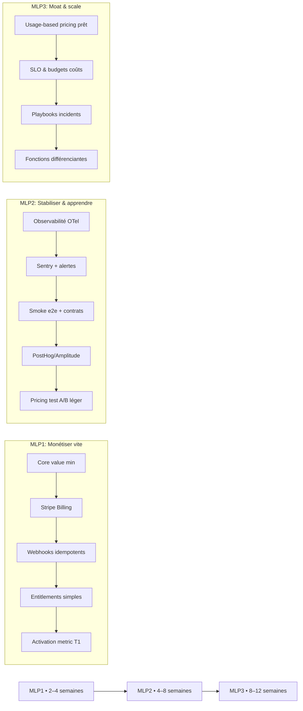

```
Est-ce que tu crois pas que demain l solopreneurs qui vont construire d saas avec l relations clients l abonnements à gérer aux us avec l us clients l différents types d'abonnements ils vont plutôt négligé et n'auront pas le temps d'améliorer en mlp 2 ou 3 le saas en tdd bdd ou m faire du debugging 

Car je pense qu'avec l'ia l'humain qui fait le debugging ça risque de disparaitre m si l'ia interprète mieux l projets faits en bdd tdd ddd y aura pas le temps avec le cout de la vie en 2025 loyers et autres 

l solopreneur devront se concentrer à fond sur le pricing avec une mentalité alex hormozi la gestion d abonnements et d abonnés clients est-ce vrai ou pas ?
```

Court et clair d’abord : **non, le debugging ne “disparaît” pas avec l’IA**, et **oui, la gestion pricing/abonnements va bouffer une grosse part du temps d’un solopreneur**. La vérité utile : tu dois “right-sizer” l’ingénierie (assez de rigueur pour ne pas te noyer en prod), tout en traitant **monétisation + rétention** comme ton sport principal. Hormozi a raison sur l’offre/pricing, mais sans un minimum de qualité/observabilité, tu monétises… du churn.

## Verdict honnête

- **Partiellement vrai** : la **gestion d’abonnements/pricing** deviendra ton quotidien — et c’est sain, parce que cashflow > ego d’ingénieur.
- **Faux** : “plus besoin de debugging”. L’IA te fait gagner du temps, mais **les vrais bugs** (intégration, données, argent, performance) vivent en prod, pas dans un REPL. Sans une **fine couche** de tests/observabilité, tu paies la note en churn et en réputation.

Si tu veux, je te bâtis un **to-do MLP1 en 20 items** (billing, webhooks, tests, métriques, flags) adapté à ton stack actuel — pour que demain matin tu puisses facturer sans te créer une bombe à retardement.

Voici le plan sans fard, orienté exécution.

------

# Ce qui va vraiment compter pour un solopreneur SaaS (2025)

## 1) Argent qui entre sans friction

- **Billing & tax** (Stripe/Paddle/Chargebee) : essais, remises, prorata, dunning, upgrades/downgrades, annuels vs mensuels, TVA/US sales tax.
- **Entitlements** clairs : quel plan déverrouille quoi, immédiatement au paiement, sans ticket support.
- **Self-serve** : portail client pour facture, carte, plan. Moins d’emails, plus de conversion.

## 2) Rétention > acquisition

- **Activation** mesurée (T1) : “North Star” simple (p. ex. 1er workflow lancé, 100 events traités, 3 intégrations connectées).
- **Rythme d’itération** > backlog héroïque : ship petit et souvent.
- **Instrumentation native** : métriques de valeur par compte (usage metric-driven pricing ready).

## 3) Rigueur d’engineering… minimale mais non négociable

- **Tests ciblés** plutôt que TDD partout :
  - “**Money paths**” (paiement, webhooks, entitlements) → tests d’intégration + contrat.
  - 1–2 **smokes e2e** (login → action clé → facturation).
  - **Feature flags** pour shipper sans casse.
- **Observabilité** dès MLP1 : logs structurés, métriques (latence, erreurs), alerte sur taux d’échec webhooks.
- **Sentry/Bugsnag + OpenTelemetry** : ton filet de sécurité quand l’IA se trompe… ou toi.

------

# L’IA change le debugging… elle ne l’élimine pas

**Ce qui baisse** : chasse aux fautes de syntaxe, scaffolding de tests, patterns standards (CRUD, mappers, DTOs).

**Ce qui monte** :

- **Bugs d’intégration et de données** (webhooks, échéances, prorata, fuseaux horaires).
- **Incidents “système”** : timeouts, backoffs, idempotence, duplication d’événements.
- **Comportements LLM non déterministes** (si tu as de l’IA inside) : garde-fous, journaux de prompts, versions.
- **Perf & coûts** (token usage, cold starts, indexations).

👉 L’IA devient ton “copilote SRE/QA”. Tu lui feras générer des tests, repro steps, hypothèses, diff de logs… mais **toi** décides des SLO, des invariants métier et des garde-fous.

------

# Faut-il enterrer TDD/BDD/DDD ?

- **TDD** : utile là où l’algo est critique/stable (tarification, règles d’éligibilité). Ailleurs, vise **tests d’intégration** guidés par l’usage.
- **BDD** : top pour aligner sur des comportements payants (ex. “quand l’utilisateur up-grade en milieu de cycle, alors…”) — même 3 scénarios Gherkin bien choisis valent de l’or.
- **DDD** : “**DDD allégé**” (agrégats simples + invariants) pour les domaines sensibles : facturation, droits d’accès, quotas. Pas besoin de sur-modéliser tout le front.

------

# Priorisation MLP1 → MLP3 (réaliste pour un solo)



------

# Stack abonnements “minimum viable, robuste”

**Modèle de données (logique)**
 `Customer` —< `Subscription` —< `SubscriptionItem` —< `Entitlement`
 `Invoice` —< `Payment`
 `UsageEvent` (optionnel) relié à `SubscriptionItem`

**Invariants à tester**

- Idempotence webhooks (clé d’événement + statut traité).
- Prorata correct au changement de plan.
- Entitlements mis à jour avant de répondre à l’utilisateur.
- Dunning : suspension contrôlée (lecture seule ?), réactivation à paiement reçu.

**Webhook flow (résumé)**

- `invoice.payment_succeeded` → upsert paiement + activer droits.
- `customer.subscription.updated` → recalcul entitlements + proration.
- `invoice.payment_failed` → marquer à “past_due”, scheduler dunning, notifier.

------

# Pricing à la Hormozi, sans te tirer une balle dans le pied

- **Value equation** : promesse mesurable + délai court + risque perçu faible (garantie, essai).
- **Ancrage** : pack “Pro/Team” visible, annuel -20%, bonus “setup” limités dans le temps.
- **Value metric** : choisis une métrique corrélée à la valeur **et** maîtrisable (events, sièges, campagnes actives).
- **Expérimente** chaque vendredi : 1 variable à la fois (prix, essai, annual only, cap sur la métrique).
- **Évite** : trop de paliers dès MLP1, coupons permanents, lifetime deals qui flinguent la trésorerie.

------

# Répartition du temps (semaine type, solo)

- **40% Monétisation & succès client** : support, calls, FAQ, onboarding, dunning, petites features “aha”.
- **40% Produit cœur** : améliorer la boucle de valeur (la chose pour laquelle on paie).
- **20% Qualité & plate-forme** : tests ciblés, observabilité, fiabilisation des webhooks, automations CI/CD.

Rythme :

- **Lun–Jeu** ship quotidien (petites PR, flags).
- **Vendredi** : rituel pricing/offre + ménage de dette + métriques de la semaine.
- **Mensuel** : revue churn/expansion/activation → une décision pricing structurante.

------

# Signaux que tu as trop sacrifié l’ingénierie

- Churn mensuel > **8–12%** (selon ARPU), NPS qui plonge, **tickets récurrents sur facturation**.
- Webhooks en file d’attente, retries sans idempotence → entitlements incohérents.
- **Lead time** > 1 semaine pour shipper une micro-feature (dettes cachées).
- Tu “fais du support” plus que tu ne construis → l’outil te possède.

# Signaux que tu as trop sacrifié le go-to-market

- DAU/WAU plat malgré des features propres.
- Peu d’upgrades, **ARPU stagnant**, pas d’apprentissage sur l’offre.
- Tu fais du refactor “pour demain” sans hypothèse business testée **cette** semaine.

------

