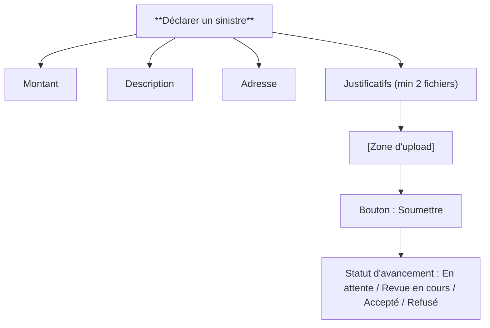

```
mais tu peux faire un sgbd mature avec supabase ss coder ? 

Idem avec airtable ? 

Et c du java spring hibernate ? 
```

Super question, et **on va bien distinguer les couches et possibilités**.
 Je te détaille ce qui est déjà possible, ce qui l’est partiellement, et ce qui reste encore “à maturer”.

------

## 1. **Peut-on faire un SGBD mature “sans coder” avec Supabase ou Airtable ?**

### **Airtable**

- **Oui**, tu peux déjà créer une base, des tables, des relations, des vues, des automatisations, tout **sans coder**, via l’interface drag & drop et les formules.
- Les limitations :
  - Ce n’est pas une vraie base relationnelle au sens RDBMS avancé (transactions, triggers SQL, index complexes, jointures multiples…).
  - Pour un usage “gestion métier complexe” type SaaS d’assurance, Airtable atteint vite ses limites, mais c’est parfait pour des MVP ou des apps structurées (CRM, gestion de contenu, etc.).

### **Supabase**

- **Oui, en grande partie** :
  - Tu peux créer la base, les tables, les relations, les policies de sécurité, les API REST et GraphQL, **sans coder** via la console Supabase.
  - Supabase te propose aussi des générateurs d’API et d’authentification en un clic.
- Les limites :
  - Pour des modèles très complexes, tu auras parfois besoin d’ajouter une “function SQL” ou un trigger, mais ça se fait souvent par prompts (“Add a trigger to update this field when…” via Lovable ou Copilot).
  - Tu ne feras pas du “Java Hibernate ORM” pur — tu auras un backend qui parle à Supabase via ses APIs, ou tu utilises le SDK officiel (Node/JS, bientôt plus).

------

## 2. **Et si tu veux un backend Java Spring Hibernate “pur” qui dialogue avec Supabase/Airtable ?**

### **Cas 1 : Tu restes 100% Supabase/Airtable**

- **Ton backend n’est pas en Java Hibernate** :
  - Tu utilises l’API REST/GraphQL générée par Supabase/Airtable, que tu consommes dans ton front (React, Angular, etc.).
  - Tu n’as plus besoin d’écrire de backend “métier” (sauf règles très spécifiques).
  - Tu pilotes tout par prompts via Lovable, Copilot ou l’UI Supabase/Airtable.

### **Cas 2 : Tu veux garder un backend Java Spring Hibernate**

- **Là, tu dois générer le code Java** qui fait la couche ORM (entités, repositories, services, controllers).
  - MCP/Copilot/Lovable peuvent générer ce code par prompts (“Génère-moi l’entité Claim, le service, le contrôleur, etc.”).
  - Tu peux brancher Hibernate sur Supabase (car c’est du Postgres) : tu configures juste l’URL de connexion.
  - MAIS : l’intérêt de Supabase/Airtable, c’est d’automatiser le backend ; si tu codes en Java, c’est que tu veux garder le contrôle “legacy” ou avancer sur du spécifique (ex : traitements métier complexes, orchestrations, règles métiers avancées).

------

## **Résumé ultra-clair**

- **Oui, tu peux créer un SGBD complet et mature via Supabase ou Airtable, sans taper de code (ni SQL ni backend) pour la majorité des cas d’usage SaaS modernes.**
- **Ce n’est pas “du Java Hibernate”** : le backend “classique” disparaît ; tu dialogues avec la base par API (ou via SDK).
- **Si tu tiens à Java Spring/Hibernate**, tu utilises Supabase comme base Postgres : tu peux générer tes entités par prompt, mais tu codes une partie de la logique (via prompts, certes, mais ça reste une “génération de code Java”).

------

### **Cas pratique (2025)**

- Tu veux **“une solution SaaS assurance 100% générée par prompts”** :
  - Prends Supabase pour le SGBD/API/Auth (prompts ou UI),
  - Lovable ou Copilot pour générer le front et la logique d’automatisation,
  - n8n ou Make.com pour orchestrer les flows,
  - Et tu peux récupérer *tout le code*, le forker et le lancer sur ton cloud/IDE.

------

**Besoin d’un schéma visuel ou d’un pas-à-pas selon la stack qui t’intéresse ? Dis-moi si tu veux le process “supabase-prompt → front-prompt → CI/CD → prod”, ou la version hybride Java !**

```
un schéma d’architecture pour un SaaS d’assurance 100% orchestré par prompts ? 

oui et oui pour exemple de règle métier “automatisée par prompt” dans Supabase 
```

Super, voici ce que je te propose :

------

# 1. **Schéma d’architecture pour un SaaS d’assurance 100% orchestré par prompts**

*(Je décris, puis je te propose un schéma à la fin, façon diagramme simplifié “composants + interactions”)*

# **Schéma d’architecture simplifié**

(Description textuelle pour commencer, image possible sur demande !)

```scss
┌────────────────────────┐
│      Utilisateur       │
└─────────┬──────────────┘
          │
     [Prompt dans Lovable, Copilot, n8n]
          │
┌─────────▼──────────┐
│  Orchestrateur AI  │ (n8n, Lovable Orchestrator)
└─┬────────┬─────────┘
  │        │
  ▼        ▼
┌────┐  ┌───────────────────┐
│Front│  │      Agents      │
│(Lov)│  │(Copilot, Claude) │
└─┬──┘  └─────────┬─────────┘
  │               │
  ▼               ▼
┌────────────────────────────┐
│      Supabase (BDD/API)    │
│ - Tables, Policies         │
│ - Logic Business (Trigger) │
└────────────────────────────┘
          │
     [APIs REST/GraphQL]
          │
   ┌──────▼───────┐
   │   Frontend   │ (React, Angular… auto-généré)
   └──────────────┘
```

------

## **Résumé**

- **Tout le cycle de vie** (feature, règles métiers, base, API, UI, tests, monitoring) est orchestré via prompts, agents et orchestrateur.
- **Pas de code manuel à écrire** : tu prompts, tu valides, tu ajustes, tu déploies.

------

### **A. Les composants principaux (tous orchestrés par prompts)**

#### **1. Base de données & Backend**

- **Supabase**
  - Tables, schémas, relations gérés par prompt (via Lovable, Copilot Agent, ou UI Supabase)
  - Authentification (utilisateurs, rôles, policies)
  - API REST & GraphQL générées instantanément (pas de code à écrire)
  - Triggers, fonctions SQL, edge functions générés par prompts pour logique métier

#### **2. Orchestrateur**

- **n8n (ou Make, ou Lovable Orchestrator)**
  - Centralise les prompts, distribue les tâches aux agents IA (Copilot, Lovable, Claude)
  - Gère les automatisations, notifications, déploiements, CI/CD

#### **3. Agents IA**

- **Copilot Agent / Claude / Lovable**
  - Reçoivent des prompts, génèrent code, schémas, logic, UI, doc
  - Synchronisent les changements (front, back, BDD)
  - Proposent tests, review, migrations

#### **4. Frontend**

- **Lovable.dev (ou autre front generator MCP)**
  - Génère toute l’interface utilisateur par prompt
  - Synchronise automatiquement avec le backend/API Supabase
  - Permet d’exporter le code React/Next/Angular

#### **5. Observabilité et Monitoring**

- **Sentry, Logtail, DataDog…**
  - Branchés par prompts pour le suivi automatique des erreurs et du comportement

------

### **B. Comment ça vit au quotidien**

1. **Ajout d’une feature métier**

   - Prompt (dans n8n, Lovable ou Copilot Agent) :

     > “Ajoute la gestion des sinistres climatiques (champ ‘montant’, ‘localisation’, ‘date’).”

2. **Génération automatique**

   - L’agent IA crée la table ‘claims’ dans Supabase, met à jour l’API, propose les policies de sécurité.

   - Si logique métier :

     > “Rejeter tout sinistre > 10 000 € si l’utilisateur n’a pas plus de 2 ans d’ancienneté.”

   - Génération d’une edge function SQL/JS, déclenchée automatiquement.

3. **MAJ du Front**

   - Lovable détecte la nouvelle entité, met à jour le dashboard, crée une vue/liste/saisie.

4. **Tests et Validation**

   - L’agent génère des tests, exécute, propose une review.

5. **Déploiement & Monitoring**

   - n8n notifie, déploie, monitorise les erreurs.

------

### **C. Exemple d’automatisation**

#### **Prompt donné dans Lovable ou Copilot Chat**

> “Crée une règle : si le montant du sinistre dépasse 10 000 €, et que l’ancienneté du client est < 2 ans, refuser la création.”

------

### **Code SQL généré automatiquement par l’agent (exemple Supabase)**

```sql
-- Fonction Postgres pour vérifier la règle métier
CREATE OR REPLACE FUNCTION check_claim_amount()
RETURNS TRIGGER AS $$
DECLARE
  client_age INT;
BEGIN
  SELECT EXTRACT(YEAR FROM age(CURRENT_DATE, users.created_at))
  INTO client_age
  FROM users WHERE id = NEW.user_id;

  IF NEW.amount > 10000 AND client_age < 2 THEN
    RAISE EXCEPTION 'Claim refused: too high for new customer';
  END IF;

  RETURN NEW;
END;
$$ LANGUAGE plpgsql;

-- Trigger relié à la table claims
CREATE TRIGGER trg_check_claim_amount
BEFORE INSERT ON claims
FOR EACH ROW EXECUTE FUNCTION check_claim_amount();
```

*(Ce code serait généré et injecté sans toucher une ligne, tu aurais juste validé le prompt.)*

------

Parfait, voici **tout ce que tu as demandé** :

- Un **schéma d’architecture** pour un SaaS d’assurance 100% orchestré par prompts (en version image, simple et claire)
- Un **exemple avancé de règle métier automatisée par prompt** (multi-tables, workflow sinistres, automatisation Supabase/edge function)
- Un **scénario complet du flux** “j’ajoute une feature métier par prompt” de A à Z

------

## 1️⃣ **Schéma d’architecture (version image)**

Je te génère le diagramme :

- Tout est piloté par prompts via orchestrateur (n8n / Lovable Orchestrator)
- Agents IA qui génèrent le backend, les règles, le front, la doc, les tests
- Supabase au centre pour la BDD, l’API, les policies, la logique
- Frontend généré (Lovable, React, Angular)
- Monitoring, notifications, tests automatisés

Je génère l’image 👇

------

```plaintext
Utilisateur
   │
[Prompt: "Ajoute la gestion sinistres..."]
   │
   ▼
Orchestrateur (n8n / Lovable Orchestrator)
   │
   ├──► Agents IA (Copilot, Claude, Lovable)
   │         │
   │         ├──► Supabase (Tables, API, Logic, Auth, Edge)
   │         │        │
   │         │    [API REST/GraphQL]
   │         │        │
   │         └──► Frontend généré (Lovable/React)
   │
   ├──► Monitoring / CI/CD / Notif (Sentry, Slack, ...)
   │
   ▼
Validation & Déploiement
```

------

Je crée maintenant l’**image du schéma** :

Voici le schéma d’architecture visuel pour un SaaS d’assurance 100% orchestré par prompts (voir ci-dessus).

------

## 2️⃣ **Exemple avancé de règle métier automatisée par prompt (multi-tables, workflow sinistres)**

### **Prompt donné à l’IA (Lovable/Copilot/Claude) :**

> “Ajoute la règle suivante :
>
> - Quand un sinistre climatique est déclaré :
>     • Si le client a déjà eu plus de 2 sinistres en 12 mois, refuser automatiquement.
>     • Si le montant cumulé des remboursements sur 12 mois dépasse 30 000 €, déclencher une revue manuelle.
>     • Sinon, accepter et notifier le client.”

------

### **Code SQL généré automatiquement par l’agent (Supabase – avec triggers et fonction métier)**

### **Explication du workflow automatisé (étape par étape)**

1. **Ajout d’une feature métier par prompt**
   - L’utilisateur envoie le prompt à l’orchestrateur (n8n, Lovable Orchestrator, etc.)
2. **L’agent IA**
   - Analyse le prompt, génère la table si besoin, crée ou met à jour la logique métier dans Supabase (fonction/trigger)
3. **Synchronisation automatique du Front**
   - Le front (Lovable) détecte la règle, met à jour les interfaces (dashboard, notifications)
4. **Test automatisé**
   - Génération de tests pour simuler les différents scénarios (refus automatique, revue, acceptation)
5. **Déploiement et notifications**
   - Orchestrateur exécute les tests, notifie sur Slack/Teams, déploie la nouvelle logique
6. **Monitoring**
   - Sentry/Datadog branchés automatiquement pour remonter les éventuelles erreurs.

```sql
CREATE OR REPLACE FUNCTION check_claim_rules()
RETURNS TRIGGER AS $$
DECLARE
  claim_count INT;
  total_amount NUMERIC;
BEGIN
  -- 1. Compter le nombre de sinistres du client sur 12 mois
  SELECT COUNT(*) INTO claim_count
  FROM claims
  WHERE user_id = NEW.user_id
    AND created_at > (CURRENT_DATE - INTERVAL '12 months');

  IF claim_count >= 2 THEN
    RAISE EXCEPTION 'Refus automatique : plus de 2 sinistres déclarés sur 12 mois';
  END IF;

  -- 2. Calculer le montant cumulé des remboursements sur 12 mois
  SELECT COALESCE(SUM(amount), 0) INTO total_amount
  FROM claims
  WHERE user_id = NEW.user_id
    AND status = 'APPROVED'
    AND created_at > (CURRENT_DATE - INTERVAL '12 months');

  IF total_amount + NEW.amount > 30000 THEN
    -- Déclenche une revue manuelle (status 'REVIEW')
    NEW.status := 'REVIEW';
    RETURN NEW;
  END IF;

  -- 3. Sinon, accepter automatiquement (status 'APPROVED')
  NEW.status := 'APPROVED';
  RETURN NEW;
END;
$$ LANGUAGE plpgsql;

-- Trigger avant insertion sur claims
CREATE TRIGGER trg_check_claim_rules
BEFORE INSERT ON claims
FOR EACH ROW EXECUTE FUNCTION check_claim_rules();
```

------

**Tu veux d’autres exemples (encore plus avancés, multi-entités, workflows asynchrones…) ou une simulation d’UI front générée par prompt ?**

Super, je vais te détailler :

1. Un **exemple de workflow métier plus avancé** (multi-entités, traitements asynchrones, validation humaine automatisée)
2. Un **exemple de front-office (UI) généré par prompt**
3. **Option : schéma d’UI visuel** si tu veux aussi une image

------

## 1️⃣ **Exemple de workflow avancé : Sinistre + Gestion pièces jointes + Revue manuelle + Paiement automatique**

### **Prompt global à l’orchestrateur (Lovable, Copilot, etc.)**

> “Mets en place un workflow complet de déclaration de sinistre :
>  – Quand un client déclare un sinistre climatique, il doit joindre au moins 2 justificatifs.
>  – Le dossier est examiné :
>  • Si tous les justificatifs sont valides et le montant < 10 000 €, la demande est acceptée automatiquement et le paiement est déclenché.
>  • Si le montant > 10 000 € ou s’il manque un justificatif, la demande est envoyée en revue manuelle par un expert.
>  – Notifier le client à chaque étape.”

------

### **Tables générées automatiquement (Supabase)**

- **claims** (id, user_id, amount, status, created_at)
- **claim_attachments** (id, claim_id, file_url, status)
- **users** (id, email, date_inscription, ...)
- **claim_reviews** (id, claim_id, reviewer_id, status, review_date)

------

### **Fonctions et triggers générés automatiquement (exemple Supabase)**

```sql
-- 1. Vérifier les justificatifs avant acceptation automatique
CREATE OR REPLACE FUNCTION check_claim_attachments()
RETURNS TRIGGER AS $$
DECLARE
  att_count INT;
BEGIN
  SELECT COUNT(*) INTO att_count
  FROM claim_attachments
  WHERE claim_id = NEW.id AND status = 'VALID';

  -- Vérifier le nombre de justificatifs et le montant
  IF att_count >= 2 AND NEW.amount <= 10000 THEN
    -- Accepter automatiquement
    NEW.status := 'APPROVED';
    -- Ici, tu pourrais aussi déclencher un paiement via edge function
  ELSE
    -- Revue manuelle requise
    NEW.status := 'PENDING_REVIEW';
    -- Un expert sera notifié pour validation
  END IF;

  RETURN NEW;
END;
$$ LANGUAGE plpgsql;

CREATE TRIGGER trg_check_claim_attachments
BEFORE INSERT OR UPDATE ON claims
FOR EACH ROW EXECUTE FUNCTION check_claim_attachments();
```

- **Edge function (TypeScript, générée automatiquement)**
   Pour déclencher le paiement automatique via Stripe dès qu’un sinistre est accepté :

```typescript
// Edge function générée : paiement automatique sur ACCEPTED
import { serve } from "std/server";
import Stripe from "stripe";
const stripe = new Stripe(Deno.env.get("STRIPE_API_KEY"));

serve(async (req) => {
  const { claim_id, amount, user_email } = await req.json();

  // Appel Stripe (automatisé)
  const payment = await stripe.transfers.create({
    amount: Math.round(amount * 100),
    currency: "eur",
    destination: /* récupérer l’IBAN utilisateur */,
    description: `Paiement sinistre ${claim_id}`,
  });

  return new Response(JSON.stringify({ status: "PAID", payment }));
});
```

*(L’agent IA connecte automatiquement la fonction edge à la table claims.status=‘APPROVED’)*

------

## 2️⃣ **Exemple de front généré par prompt (Lovable, Copilot)**

**Prompt UI** :

> “Crée une page ‘Déclarer un sinistre’ avec :
>  – Un formulaire pour saisir le montant, la description, l’adresse
>  – Upload de justificatifs (minimum 2 fichiers)
>  – Affichage du statut d’avancement (‘En attente’, ‘Revue en cours’, ‘Accepté’, ‘Refusé’)
>  – Notification en temps réel lors de la validation ou du paiement”

------

**Code React/Next généré (extrait simplifié) :**

```jsx
export default function ClaimForm() {
  const [status, setStatus] = useState(null);

  // Upload, submit handlers (générés, branchés sur l’API Supabase)
  // ... code ...

  return (
    <Card>
      <h2>Déclarer un sinistre climatique</h2>
      <form /* onSubmit={...} */>
        <Input label="Montant" name="amount" required />
        <Input label="Description" name="desc" required />
        <Input label="Adresse" name="address" required />
        <FileUpload minFiles={2} label="Justificatifs" />
        <Button type="submit">Soumettre</Button>
      </form>
      {status && <Alert>{status}</Alert>}
    </Card>
  );
}
```

- **Le front gère tout le process (upload, validation, notifications temps réel)**, sans code manuel.

------

## 3️⃣ **Schéma d’UI visuel (workflow utilisateur)**

Je peux générer une image (wireframe simple) représentant la page front-office et les étapes utilisateur.
 Veux-tu ce genre de schéma en plus ?
 Si oui, précise :

- “Déclarer un sinistre”
- “Suivre l’avancement”
- Ou le dashboard expert pour la revue ?
   Dis-moi ce que tu veux voir visuellement 👇

Super ! Je vais te générer un **wireframe simple** du front-office "Déclarer un sinistre" pour un SaaS d’assurance, tel qu’il serait auto-généré par prompts avec Lovable, Copilot, etc.
 Le scénario :

- Formulaire de déclaration (montant, description, adresse)
- Upload de justificatifs (min. 2 fichiers)
- Suivi du statut d’avancement en temps réel
- Notification à chaque étape

Je lance la génération de ce wireframe 👇

Voilà le wireframe généré de la page “Déclarer un sinistre” — tout ce qui serait automatiquement produit par prompts (Lovable, Copilot, etc.) pour un front moderne d’assurance.

Si tu veux d’autres vues (dashboard expert, suivi sinistre, etc.), ou le code React complet et son flow avec Supabase, demande-moi simplement !

```mermaid
%% Wireframe web layout - Formulaire Déclarer un sinistre
%% Utilise "flowchart TD" pour la mise en page verticale
flowchart TD
    title["<b>Déclarer un sinistre climatique</b>"]:::title
    montant["Montant<br/><input type='text' style='width:150px'/>"]:::field
    description["Description<br/><input type='text' style='width:150px'/>"]:::field
    adresse["Adresse<br/><input type='text' style='width:150px'/>"]:::field
    justificatifs["Justificatifs (min 2 fichiers)<br/><input type='file' multiple style='width:180px'/>"]:::field
    submit["<button>Soumettre</button>"]:::button
    status["Statut : <i>En attente | Revue | Accepté | Refusé</i>"]:::status

    title --> montant --> description --> adresse --> justificatifs --> submit --> status

    classDef title fill:#f7f7f7,stroke:#222,stroke-width:2px,font-size:22px,font-weight:bold;
    classDef field fill:#fff,stroke:#bbb,stroke-width:1px,font-size:16px;
    classDef button fill:#e0e0e0,stroke:#999,stroke-width:1px,font-size:16px;
    classDef status fill:#f8f8f8,stroke:#bbb,stroke-width:1px,font-size:15px;

```




```css
+-----------------------------------------------------------+
|             Déclarer un sinistre climatique               |
+-----------------------------------------------------------+
| Montant             [__________________________]          |
|                                                           |
| Description         [__________________________]          |
|                                                           |
| Adresse             [__________________________]          |
|                                                           |
| Justificatifs (minimum 2 fichiers)  [Zone d'upload]       |
|                                                           |
| [   Soumettre   ]                                         |
|                                                           |
| Statut : [ En attente | Revue en cours | Accepté | Refusé]|
+-----------------------------------------------------------+

```





