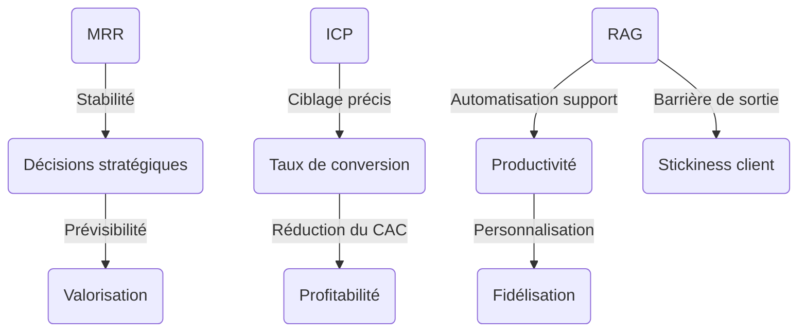

## **Synthèse terrain**

- **MRR élevé et stable** = feu vert pour scaler ou lever des fonds.
- **ICP bien défini** = effort minimal, acquisition maximale.
- **RAG propriétaire** = fidélisation extrême, actif intangible.

**Exemple terrain chiffré :**

- Tu cibles 100 ICP, conversion 20 %, panier moyen 800 €/mois :
  - MRR = 16 000 €/mois (si churn < 3 %, business très sain)
- Le RAG fait gagner 15 h/mois/client = 1 200 €/mois de valeur économique.
- Barrière de sortie : coût replatforming > 8 k €, faible appétence à quitter.

## **Résumé visuel**

